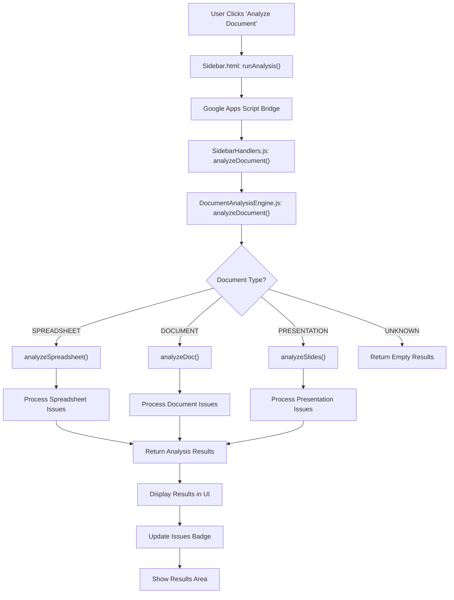
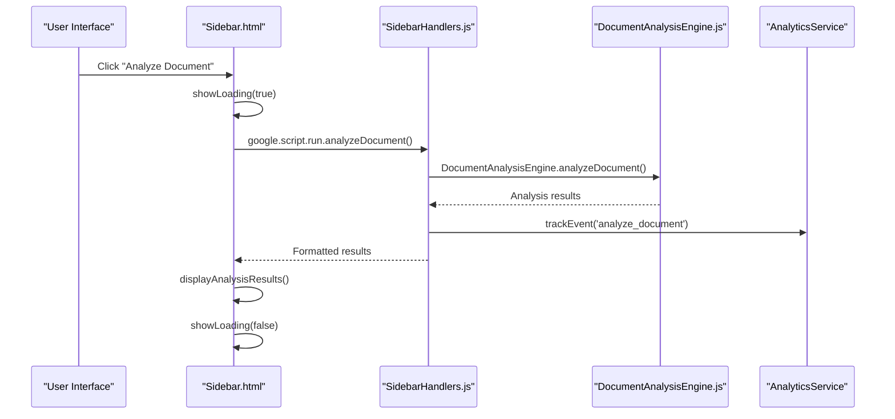
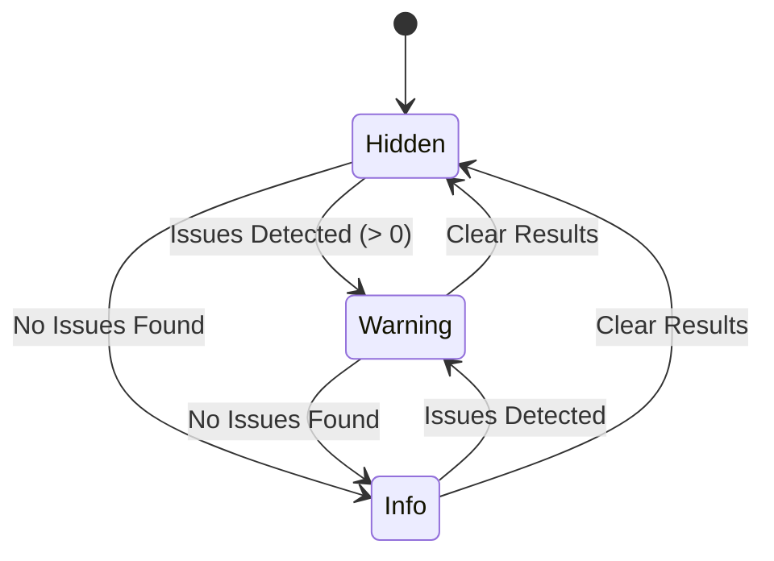
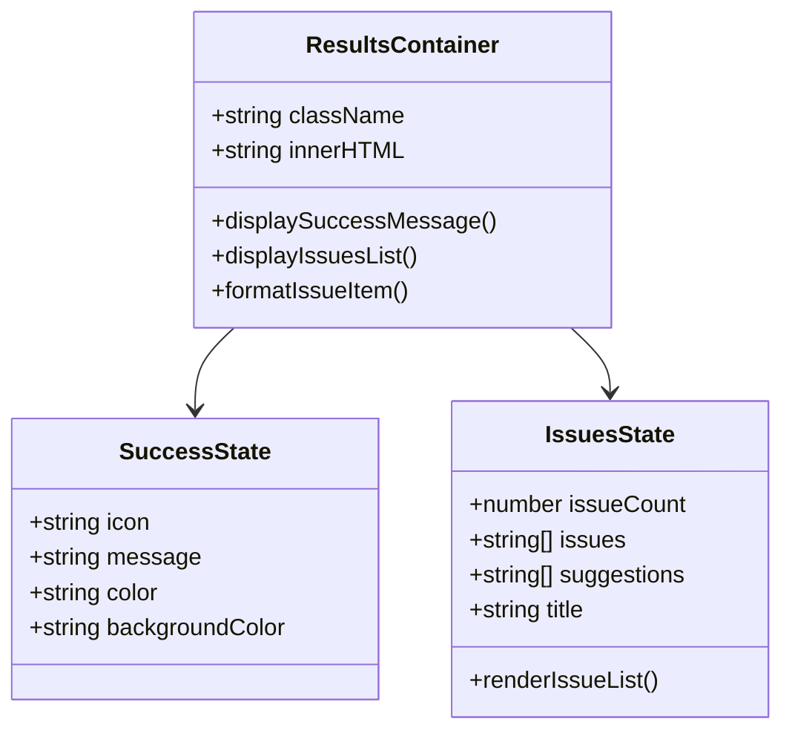

# Document Analysis Workflow

<cite>
**Referenced Files in This Document**
- [Sidebar.html](file://src/ui/Sidebar.html)
- [SidebarHandlers.js](file://src/handlers/SidebarHandlers.js)
- [DocumentAnalysisEngine.js](file://src/services/DocumentAnalysisEngine.js)
- [Main.js](file://src/Main.js)
- [README.md](file://README.md)
</cite>

## Table of Contents
1. [Introduction](#introduction)
2. [Workflow Overview](#workflow-overview)
3. [User Interaction Flow](#user-interaction-flow)
4. [Technical Implementation](#technical-implementation)
5. [Visual Feedback System](#visual-feedback-system)
6. [Analysis Results Display](#analysis-results-display)
7. [Automatic Analysis](#automatic-analysis)
8. [Common Formatting Issues Detected](#common-formatting-issues-detected)
9. [Error Handling and Recovery](#error-handling-and-recovery)
10. [Performance Considerations](#performance-considerations)

## Introduction

The Document Analysis Workflow in the Techno Browser extension provides intelligent document assessment capabilities across Google Docs, Sheets, and Slides. This comprehensive system automatically detects formatting issues, identifies anomalies, and presents actionable suggestions to users while maintaining privacy-first processing standards.

The workflow consists of three primary phases: user initiation through the sidebar interface, backend analysis execution, and visual feedback presentation. Each phase is designed to provide seamless, real-time document assessment with immediate actionable insights.

## Workflow Overview

The document analysis workflow follows a structured execution pattern that ensures reliable and efficient document assessment across different Google Workspace applications.

**Diagram sources**
- [Sidebar.html](file://src/ui/Sidebar.html#L328-L334)
- [SidebarHandlers.js](file://src/handlers/SidebarHandlers.js#L10-L20)
- [DocumentAnalysisEngine.js](file://src/services/DocumentAnalysisEngine.js#L12-L30)

## User Interaction Flow

The user interaction begins when users click the "Analyze Document" action card in the Analyze tab. This triggers a multi-stage process that transforms user input into comprehensive document assessment results.

### Initial User Action

Users initiate analysis by clicking the prominent "🔍 Analyze Document" action card located in the Analyze tab's Quick Actions section. This action immediately activates the loading state and initiates the analysis process.

### Loading State Activation

The interface transitions to a loading state featuring a spinning animation and processing message. This visual feedback assures users that the analysis is actively underway and prevents accidental repeated submissions.

### Analysis Execution

The system executes a comprehensive analysis tailored to the current document type, detecting various formatting issues, inconsistencies, and potential improvements. The analysis considers document structure, content patterns, and formatting standards.

### Result Presentation

Upon completion, the system presents results through a structured interface displaying detected issues, actionable suggestions, and visual indicators of analysis status.

**Section sources**
- [Sidebar.html](file://src/ui/Sidebar.html#L218-L224)
- [Sidebar.html](file://src/ui/Sidebar.html#L328-L334)

## Technical Implementation

The technical implementation spans multiple layers of abstraction, ensuring maintainable and scalable document analysis capabilities.

### Frontend Handler Layer

The frontend handler layer manages user interface interactions and communicates with the backend analysis engine through Google Apps Script's client-server bridge.

**Diagram sources**
- [Sidebar.html](file://src/ui/Sidebar.html#L328-L334)
- [SidebarHandlers.js](file://src/handlers/SidebarHandlers.js#L10-L20)

### Backend Analysis Engine

The backend analysis engine serves as the core processing component, implementing specialized analysis logic for different document types while maintaining consistent result formatting.

#### Document Type Detection

The system automatically detects the current document type and applies appropriate analysis algorithms:

- **Spreadsheet Analysis**: Focuses on data consistency, duplicate detection, and formatting issues
- **Document Analysis**: Examines text formatting, heading consistency, and content quality
- **Presentation Analysis**: Evaluates slide structure, font consistency, and content balance

#### Analysis Algorithm Implementation

Each analysis type employs sophisticated algorithms to detect specific issue categories:

- Pattern recognition for formatting inconsistencies
- Statistical analysis for anomaly detection
- Heuristic-based quality assessment
- Context-aware suggestion generation

**Section sources**
- [SidebarHandlers.js](file://src/handlers/SidebarHandlers.js#L10-L20)
- [DocumentAnalysisEngine.js](file://src/services/DocumentAnalysisEngine.js#L12-L30)

## Visual Feedback System

The visual feedback system provides immediate and intuitive communication of analysis status and results through multiple visual indicators.

### Issues Badge Mechanism

The issues badge serves as the primary visual indicator of analysis results, dynamically updating based on detected issues:

**Diagram sources**
- [Sidebar.html](file://src/ui/Sidebar.html#L341-L356)

#### Badge States and Styling

The badge employs distinct visual states to communicate analysis outcomes:

- **Hidden State**: No analysis has been performed or results cleared
- **Warning State**: Issues detected (yellow badge with issue count)
- **Info State**: No issues found (blue badge with success indicator)

#### Dynamic Badge Updates

The badge updates automatically based on analysis results, providing immediate visual feedback without requiring manual refresh.

### Loading Animation System

The loading animation system ensures users receive continuous feedback during analysis execution:

- **Spinner Animation**: Rotating blue spinner indicating active processing
- **Processing Message**: Clear indication that analysis is in progress
- **Progress Indication**: Visual assurance that the system is responsive

**Section sources**
- [Sidebar.html](file://src/ui/Sidebar.html#L323-L325)
- [Sidebar.html](file://src/ui/Sidebar.html#L341-L356)

## Analysis Results Display

The analysis results display system presents detected issues and suggestions in a structured, actionable format that enables users to understand and address document quality concerns effectively.

### Success State Display

When no issues are detected, the system presents a positive, encouraging message:

- **Success Indicator**: Green checkmark symbol
- **Positive Message**: "Document looks great!" with appropriate styling
- **Visual Confirmation**: Green results area with success styling

### Issue Detection Display

When issues are detected, the system provides comprehensive information:

- **Issue Count**: Total number of detected issues
- **Individual Issues**: Detailed description of each identified problem
- **Suggestions**: Actionable recommendations for resolution
- **Visual Organization**: Structured presentation with consistent formatting

### Results Area Structure

The results area employs a standardized structure for consistent user experience:

**Diagram sources**
- [Sidebar.html](file://src/ui/Sidebar.html#L346-L356)

**Section sources**
- [Sidebar.html](file://src/ui/Sidebar.html#L336-L356)

## Automatic Analysis

The system implements automatic analysis capabilities that enhance user experience by providing immediate document assessment upon sidebar initialization.

### Automatic Analysis Trigger

Automatic analysis executes when the sidebar loads, providing users with immediate insights into document quality without requiring manual intervention. This feature ensures users receive valuable feedback as soon as they access the tool.

### Implementation Details

The automatic analysis is triggered through the window onload event handler, which calls the `runAnalysis()` function automatically when the sidebar becomes available. This implementation ensures consistent behavior across different user sessions and document types.

### Benefits of Automatic Analysis

- **Immediate Feedback**: Users receive instant document assessment
- **Reduced Manual Steps**: Eliminates need for explicit analysis initiation
- **Enhanced User Experience**: Provides proactive document quality insights
- **Consistent Behavior**: Predictable analysis execution across sessions

**Section sources**
- [Sidebar.html](file://src/ui/Sidebar.html#L487-L489)

## Common Formatting Issues Detected

The Document Analysis Engine identifies a comprehensive range of formatting issues across different document types, providing targeted solutions for each category.

### Spreadsheet Analysis Issues

#### Data Quality Issues
- **Empty Rows**: Detection of completely empty rows that clutter data
- **Duplicate Rows**: Identification of identical or near-identical data entries
- **Mixed Data Types**: Columns containing inconsistent data formats
- **Empty Cells**: Blank cells within data ranges requiring attention

#### Date Format Inconsistencies
The system detects and reports date format variations within columns, helping maintain data consistency and enabling reliable data processing.

#### Column Structure Problems
- **Inconsistent Formatting**: Different formatting approaches within columns
- **Missing Headers**: Absence of proper column headers
- **Data Type Conflicts**: Numeric values mixed with text in inappropriate columns

### Document Analysis Issues

#### Text Formatting Problems
- **Multiple Spaces**: Consecutive spaces that affect readability
- **Punctuation Spacing**: Incorrect spacing around punctuation marks
- **Capitalization Errors**: Inconsistent capitalization patterns
- **Sentence Structure**: Grammatical and structural issues

#### Content Quality Issues
- **Spelling Mistakes**: Common misspellings and typographical errors
- **Repeated Words**: Accidental repetition of words or phrases
- **Long Paragraphs**: Overly lengthy paragraphs reducing readability
- **Heading Inconsistencies**: Inappropriate heading hierarchy or formatting

#### List and Formatting Issues
- **Inconsistent Bullets**: Mixed bullet point styles within lists
- **Numbering Problems**: Incorrect or inconsistent numbered lists
- **Paragraph Formatting**: Inconsistent paragraph styling and spacing

### Presentation Analysis Issues

#### Slide Content Problems
- **Text Density**: Slides with excessive text requiring simplification
- **Content Imbalance**: Uneven distribution of content across slides
- **Information Overload**: Slides containing too much information

#### Visual Consistency Issues
- **Font Variations**: Multiple fonts used inconsistently
- **Size Inconsistencies**: Inconsistent font sizes across slides
- **Color Scheme**: Lack of consistent visual themes

#### Structural Problems
- **Missing Speaker Notes**: Insufficient or absent speaker notes
- **Layout Inconsistencies**: Inconsistent slide layouts
- **Content Organization**: Poor content flow and structure

**Section sources**
- [DocumentAnalysisEngine.js](file://src/services/DocumentAnalysisEngine.js#L36-L84)
- [DocumentAnalysisEngine.js](file://src/services/DocumentAnalysisEngine.js#L91-L158)
- [DocumentAnalysisEngine.js](file://src/services/DocumentAnalysisEngine.js#L165-L196)

## Error Handling and Recovery

The system implements comprehensive error handling mechanisms to ensure robust operation and graceful degradation when issues occur.

### Error Detection and Reporting

The error handling system captures various failure scenarios:

- **Analysis Failures**: Issues during document analysis execution
- **Communication Errors**: Problems with Google Apps Script bridge
- **Resource Limitations**: Memory or processing constraints
- **Unexpected Conditions**: Unhandled exceptions and edge cases

### Error Response Strategies

When errors occur, the system employs several response strategies:

- **Graceful Degradation**: Continues with partial functionality when possible
- **User Notification**: Clear error messages informing users of issues
- **Fallback Processing**: Alternative processing methods for critical failures
- **Logging and Monitoring**: Comprehensive logging for debugging and improvement

### Recovery Mechanisms

The system provides multiple recovery mechanisms:

- **Automatic Retry**: Reattempt failed operations with exponential backoff
- **Partial Results**: Return available results when complete analysis fails
- **Safe Defaults**: Provide reasonable defaults when analysis encounters issues
- **User Guidance**: Clear instructions for resolving common error conditions

**Section sources**
- [SidebarHandlers.js](file://src/handlers/SidebarHandlers.js#L17-L20)
- [DocumentAnalysisEngine.js](file://src/services/DocumentAnalysisEngine.js#L26-L29)

## Performance Considerations

The document analysis workflow is designed with performance optimization in mind, ensuring responsive user experience across various document sizes and complexities.

### Processing Efficiency

The system implements several optimization strategies:

- **Lazy Loading**: Analysis results are generated on-demand
- **Incremental Processing**: Large documents processed in manageable chunks
- **Caching Mechanisms**: Results cached to avoid redundant processing
- **Resource Management**: Efficient memory and processing resource utilization

### Scalability Factors

The workflow scales effectively across different document characteristics:

- **Small Documents**: Instantaneous analysis for brief content
- **Medium Documents**: Responsive processing for typical documents
- **Large Documents**: Optimized chunked processing for extensive content
- **Complex Documents**: Specialized algorithms for intricate formatting

### User Experience Optimization

Performance considerations enhance user experience through:

- **Progress Indicators**: Visual feedback during processing
- **Responsive Interfaces**: Non-blocking UI during analysis
- **Quick Results**: Fast initial results with detailed processing in background
- **Timeout Management**: Appropriate timeout handling for large documents

The system balances thoroughness with responsiveness, ensuring comprehensive analysis without compromising user experience. Performance monitoring and optimization continue to evolve based on user feedback and usage patterns.