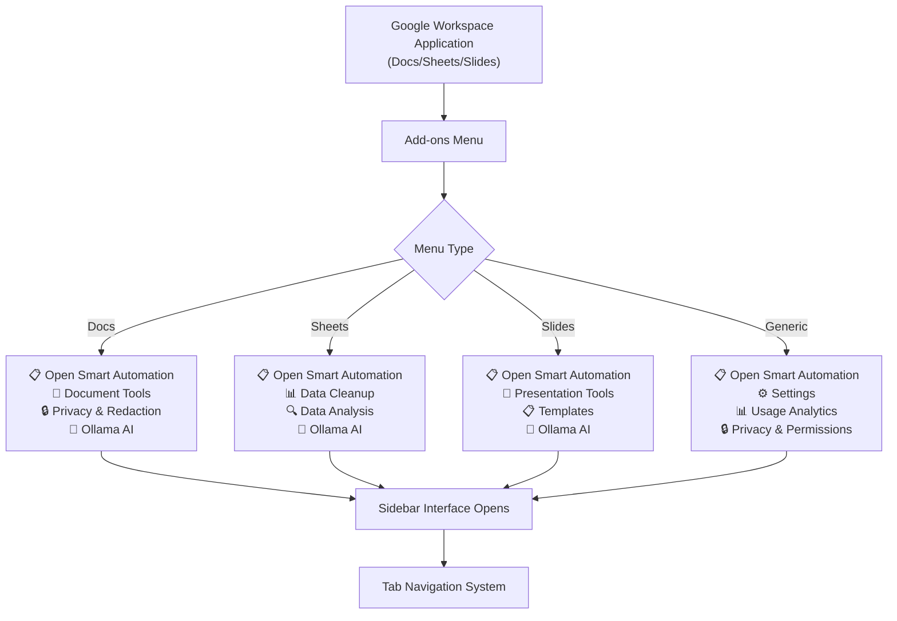
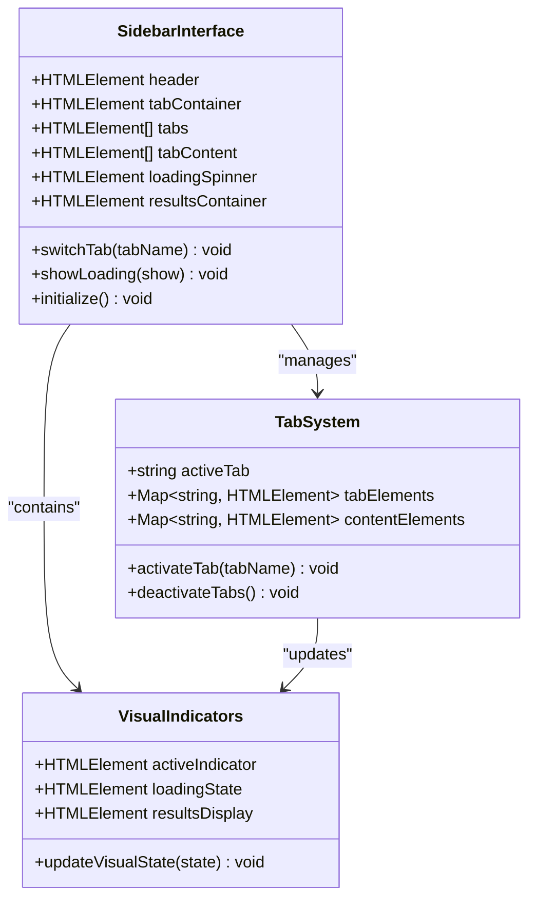
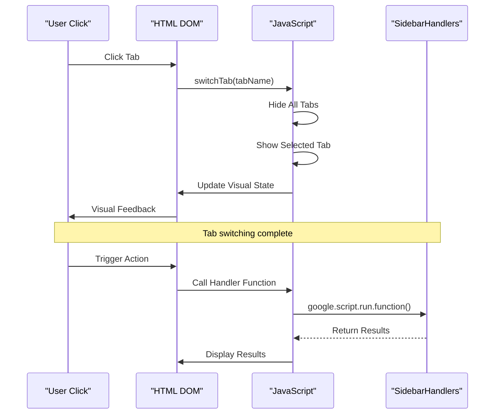
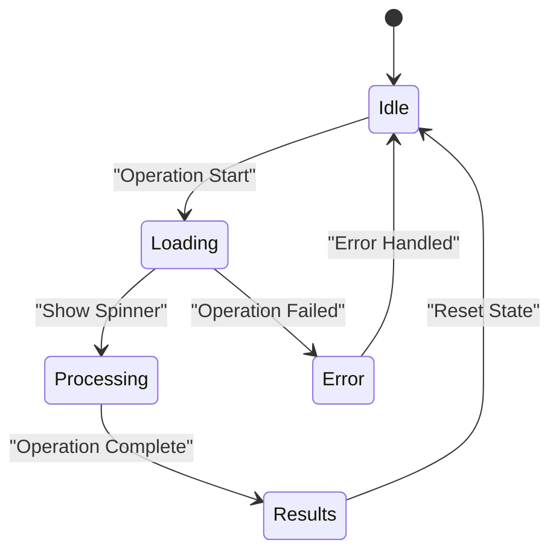
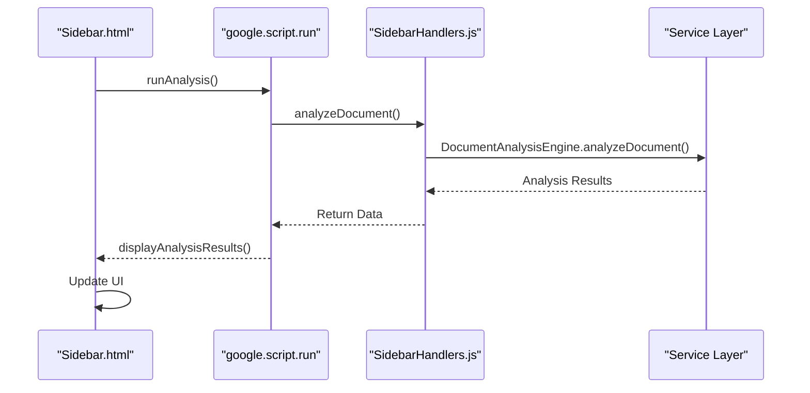

# Navigation

<cite>
**Referenced Files in This Document**
- [Sidebar.html](file://src/ui/Sidebar.html)
- [SidebarHandlers.js](file://src/handlers/SidebarHandlers.js)
- [Main.js](file://src/Main.js)
- [appsscript.json](file://appsscript.json)
- [DocumentAnalysisEngine.js](file://src/services/DocumentAnalysisEngine.js)
- [TemplateManager.js](file://src/services/TemplateManager.js)
</cite>

## Table of Contents
1. [Introduction](#introduction)
2. [Accessing the Add-on](#accessing-the-add-on)
3. [Sidebar Interface Architecture](#sidebar-interface-architecture)
4. [Tab-Based Navigation System](#tab-based-navigation-system)
5. [Visual Indicators and User Feedback](#visual-indicators-and-user-feedback)
6. [JavaScript Communication Flow](#javascript-communication-flow)
7. [Header and Loading System](#header-and-loading-system)
8. [Results Display Areas](#results-display-areas)
9. [Navigation Implementation Details](#navigation-implementation-details)
10. [Best Practices and Guidelines](#best-practices-and-guidelines)

## Introduction

The Techno Browser extension provides a sophisticated navigation system that enables users to seamlessly access and interact with intelligent automation features through Google Workspace applications. The navigation system consists of two primary pathways: direct access via the Google Workspace Add-ons menu and contextual access through application-specific menus. The core interface is built around a modern tabbed sidebar that organizes functionality into four distinct categories: Analyze, Redact, Clean, and Templates.

## Accessing the Add-on

### Google Workspace Add-ons Menu Integration

Users can access the Techno Browser extension through multiple entry points within Google Workspace applications. The add-on integrates seamlessly with Google Docs, Sheets, and Slides through dedicated menu items that adapt to the specific context of the active document.

**Diagram sources**
- [Main.js](file://src/Main.js#L38-L126)

### Direct Sidebar Access

The primary method of accessing the extension is through the "📋 Open Smart Automation" menu item, which immediately launches the main sidebar interface. This direct access bypasses intermediate menus and provides instant access to all core functionality.

**Section sources**
- [Main.js](file://src/Main.js#L150-L161)

## Sidebar Interface Architecture

### HTML Structure and Styling

The sidebar interface is built using a responsive HTML structure with Google Material Design principles. The layout follows a consistent pattern across all tabs while maintaining visual hierarchy and accessibility standards.

**Diagram sources**
- [Sidebar.html](file://src/ui/Sidebar.html#L198-L211)

### Responsive Design Principles

The interface adapts to different screen sizes and maintains usability across various devices. The 320px width constraint ensures optimal readability while providing ample space for interactive elements.

**Section sources**
- [Sidebar.html](file://src/ui/Sidebar.html#L1-L198)

## Tab-Based Navigation System

### Four Main Tabs

The navigation system is organized into four primary tabs, each serving distinct automation purposes:

#### Analyze Tab (📊)
- **Purpose**: Document analysis and content intelligence
- **Primary Functions**: Document analysis, summarization, issue detection
- **Visual Indicator**: Active state with blue underline and bold text
- **Default State**: Automatically activated on sidebar load

#### Redact Tab (🔒)
- **Purpose**: Privacy protection and sensitive data handling
- **Primary Functions**: PII detection, data redaction, privacy compliance
- **Visual Indicator**: Active state with blue underline and bold text
- **Dynamic Badge**: Shows issue count with warning indicators

#### Clean Tab (✨)
- **Purpose**: Data cleanup and formatting automation
- **Primary Functions**: Duplicate removal, date standardization, cell filling
- **Visual Indicator**: Active state with blue underline and bold text
- **Progress Tracking**: Real-time operation feedback

#### Templates Tab (📋)
- **Purpose**: Document templating and formatting
- **Primary Functions**: Template browsing, application, style management
- **Visual Indicator**: Active state with blue underline and bold text
- **Interactive Elements**: Template picker integration

**Diagram sources**
- [Sidebar.html](file://src/ui/Sidebar.html#L307-L320)

### Tab Switching Implementation

The tab switching mechanism utilizes a centralized JavaScript function that manages visual state and content visibility. The implementation follows a consistent pattern across all tabs:

**Section sources**
- [Sidebar.html](file://src/ui/Sidebar.html#L307-L320)

## Visual Indicators and User Feedback

### Active Tab Indicators

The navigation system employs multiple visual cues to indicate the currently active tab and provide immediate feedback:

#### Border Underline System
- **Active State**: Blue border bottom (2px) with matching text color
- **Hover State**: Enhanced visual feedback with subtle animations
- **Inactive State**: Transparent border with gray text

#### Dynamic Badges
- **Issue Count**: Real-time display of detected issues with color-coded indicators
- **Status Updates**: Progress indicators during operations
- **Success Confirmation**: Green checkmarks for completed actions

### Loading States

The interface provides comprehensive loading feedback through multiple mechanisms:

#### Spinner Animation
- **Position**: Centered within loading container
- **Color Scheme**: Blue spinner against white background
- **Animation**: Smooth 1-second rotation cycle
- **Trigger**: Automatic display during async operations

#### Loading Text
- **Message**: "Processing..." with contextual updates
- **Timing**: Appears immediately with spinner
- **Duration**: Matches operation completion

**Diagram sources**
- [Sidebar.html](file://src/ui/Sidebar.html#L301-L304)

**Section sources**
- [Sidebar.html](file://src/ui/Sidebar.html#L134-L153)

## JavaScript Communication Flow

### google.script.run Architecture

The sidebar interface communicates with backend services through Google Apps Script's `google.script.run` mechanism, enabling seamless client-server interaction without page reloads.

**Diagram sources**
- [Sidebar.html](file://src/ui/Sidebar.html#L327-L336)
- [SidebarHandlers.js](file://src/handlers/SidebarHandlers.js#L10-L20)

### Error Handling Mechanisms

The communication system implements robust error handling at multiple levels:

#### Frontend Error Management
- **Alert System**: User-friendly error messages
- **Loading State Reset**: Automatic loading indicator closure
- **Fallback Responses**: Graceful degradation for failed operations

#### Backend Error Propagation
- **Exception Logging**: Comprehensive error tracking
- **Structured Error Objects**: Consistent error response format
- **User Notification**: Clear error reporting to users

**Section sources**
- [Sidebar.html](file://src/ui/Sidebar.html#L480-L484)
- [SidebarHandlers.js](file://src/handlers/SidebarHandlers.js#L11-L20)

## Header and Loading System

### Header Section Design

The header section establishes the interface identity and provides essential information:

#### Branding Elements
- **Iconography**: Robot emoji (🤖) representing automation
- **Typography**: Google Sans font family with consistent hierarchy
- **Color Scheme**: Primary blue accent with neutral text colors

#### Information Display
- **Application Context**: Automatic detection of document type
- **Feature Highlight**: Brief description of automation capabilities
- **Version Information**: Integration with Google Workspace ecosystem

### Loading System Implementation

The loading system provides comprehensive feedback during asynchronous operations:

#### Spinner Animation Details
- **CSS Animation**: Keyframe-based rotation with smooth transitions
- **Performance Optimization**: Hardware-accelerated transforms
- **Accessibility Considerations**: Screen reader compatible

#### Timing and User Experience
- **Immediate Feedback**: Loading indicators appear instantly
- **Operation Duration**: Matches backend processing time
- **Completion Detection**: Automatic dismissal upon operation completion

**Section sources**
- [Sidebar.html](file://src/ui/Sidebar.html#L200-L204)
- [Sidebar.html](file://src/ui/Sidebar.html#L301-L304)

## Results Display Areas

### Results Container Architecture

Each tab contains dedicated results display areas that provide structured feedback for completed operations:

#### Analysis Results
- **Format**: Green success banner with blue title
- **Content**: Detected issues with detailed descriptions
- **Interactivity**: Expandable issue listings with individual details

#### Redaction Results
- **Format**: Yellow warning banner with orange title
- **Content**: PII detection summary with item previews
- **Confirmation**: Success messages for completed redactions

#### Cleanup Results
- **Format**: Standard green success banner
- **Content**: Operation summaries with action counts
- **Feedback**: Immediate visual confirmation of changes

#### Template Results
- **Format**: Standard green success banner
- **Content**: Template application confirmation
- **Integration**: Drive picker results display

### Visual Feedback Patterns

The results system maintains consistent visual patterns across all tabs:

#### Color Coding System
- **Success**: Green banners with positive reinforcement
- **Warning**: Yellow banners with cautionary messaging
- **Information**: Blue banners with informational content

#### Typography Standards
- **Titles**: Bold font weight with consistent sizing
- **Descriptions**: Standard text with appropriate line spacing
- **Labels**: Clear categorization with icon support

**Section sources**
- [Sidebar.html](file://src/ui/Sidebar.html#L336-L357)
- [Sidebar.html](file://src/ui/Sidebar.html#L383-L396)

## Navigation Implementation Details

### Initialization Process

The navigation system initializes automatically when the sidebar loads, providing immediate access to functionality:

#### Automatic Analysis
- **Startup Behavior**: Document analysis runs automatically
- **Background Processing**: Non-blocking operation during initialization
- **Progressive Disclosure**: Results displayed as they become available

#### Tab State Management
- **Default Selection**: Analyze tab activated by default
- **Persistence**: Tab state maintained across user interactions
- **Recovery**: Automatic restoration of previous state on reload

### Event Handling Architecture

The navigation system implements a comprehensive event handling architecture:

#### Click Event Management
- **Delegation Pattern**: Centralized event handling for tab switching
- **Performance Optimization**: Efficient DOM traversal and manipulation
- **Accessibility Support**: Keyboard navigation compatibility

#### State Synchronization
- **Visual Consistency**: Immediate UI updates reflecting state changes
- **Data Integrity**: Consistent state across all interface components
- **User Experience**: Seamless transitions between states

**Section sources**
- [Sidebar.html](file://src/ui/Sidebar.html#L486-L489)

## Best Practices and Guidelines

### User Experience Recommendations

#### Navigation Clarity
- **Visual Hierarchy**: Clear distinction between active and inactive states
- **Consistent Patterns**: Uniform behavior across all tabs and operations
- **Feedback Timing**: Immediate visual feedback for user actions

#### Accessibility Standards
- **Keyboard Navigation**: Full keyboard support for all interactive elements
- **Screen Reader Compatibility**: Proper ARIA attributes and semantic markup
- **Color Contrast**: High contrast ratios meeting WCAG guidelines

#### Performance Optimization
- **Lazy Loading**: Content loaded only when tabs are activated
- **Memory Management**: Efficient DOM element cleanup and reuse
- **Network Efficiency**: Optimized API calls with proper error handling

### Development Guidelines

#### Code Organization
- **Separation of Concerns**: Clear distinction between UI and business logic
- **Modular Design**: Reusable components with well-defined interfaces
- **Documentation Standards**: Comprehensive inline documentation

#### Testing Strategies
- **Unit Testing**: Individual function testing with mock dependencies
- **Integration Testing**: End-to-end workflow validation
- **User Acceptance Testing**: Real-world usage scenarios

#### Maintenance Considerations
- **Version Compatibility**: Backward compatibility with Google Workspace APIs
- **Performance Monitoring**: Regular performance audits and optimization
- **Security Practices**: Secure data handling and privacy compliance

The navigation system represents a sophisticated balance between functionality and usability, providing users with intuitive access to powerful automation capabilities while maintaining visual consistency and responsive performance across all supported Google Workspace applications.