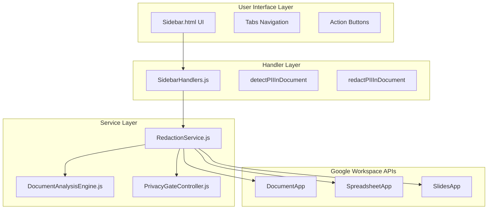
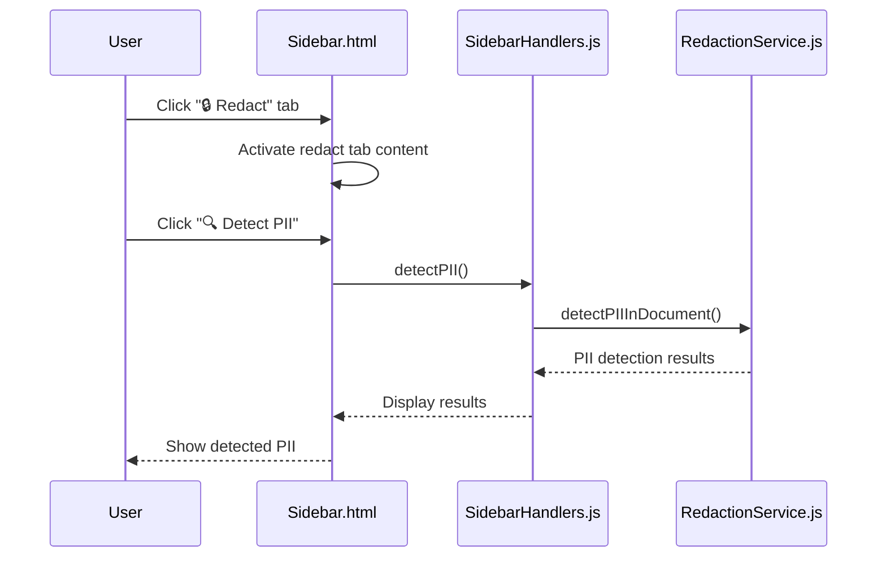
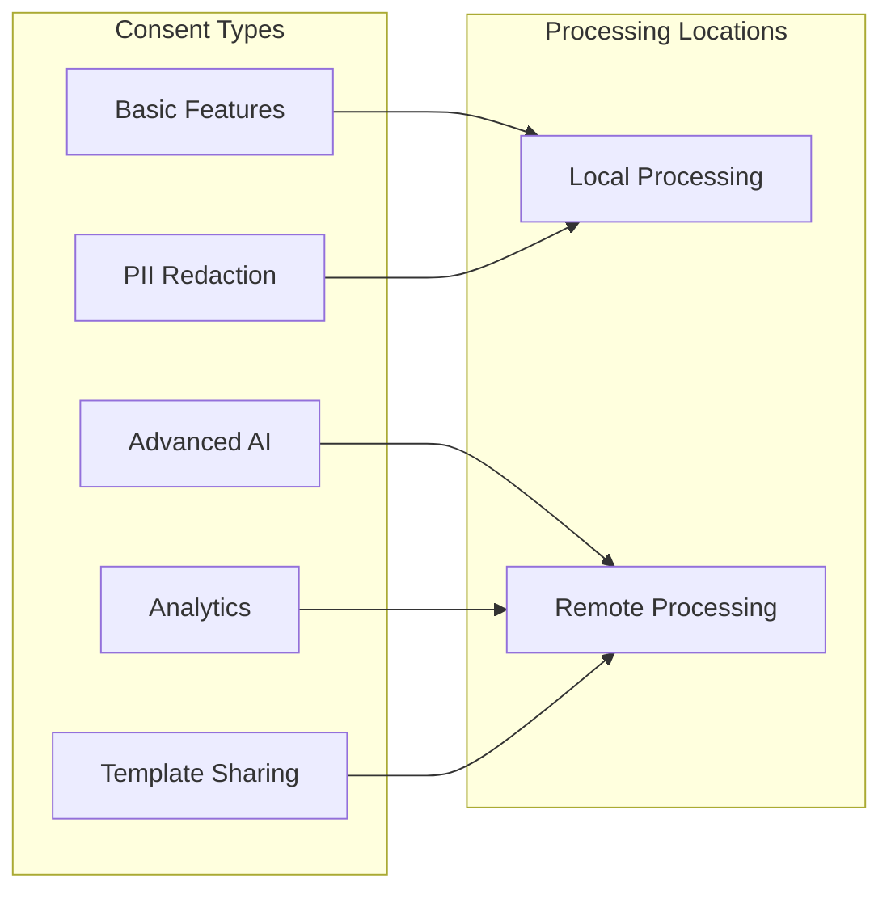

# Redaction Workflow

<cite>
**Referenced Files in This Document**
- [Sidebar.html](file://src/ui/Sidebar.html)
- [SidebarHandlers.js](file://src/handlers/SidebarHandlers.js)
- [RedactionService.js](file://src/services/RedactionService.js)
- [DocumentAnalysisEngine.js](file://src/services/DocumentAnalysisEngine.js)
- [PrivacyGateController.js](file://src/services/PrivacyGateController.js)
- [AnalyticsService.js](file://src/services/AnalyticsService.js)
</cite>

## Table of Contents
1. [Introduction](#introduction)
2. [System Architecture](#system-architecture)
3. [User Interface Navigation](#user-interface-navigation)
4. [PII Detection Workflow](#pii-detection-workflow)
5. [PII Redaction Workflow](#pii-redaction-workflow)
6. [Privacy and Consent Management](#privacy-and-consent-management)
7. [Visual Feedback System](#visual-feedback-system)
8. [Supported PII Types](#supported-pii-types)
9. [Error Handling and Edge Cases](#error-handling-and-edge-cases)
10. [Performance Considerations](#performance-considerations)
11. [Troubleshooting Guide](#troubleshooting-guide)

## Introduction

The Techno Browser extension's PII redaction workflow provides users with powerful tools to detect and redact sensitive personal information from Google Workspace documents. The system implements a comprehensive privacy-first approach with granular consent management, supporting multiple document types including Google Docs, Sheets, and Slides.

The redaction workflow consists of two primary functions: **Detect PII** and **Redact Sensitive Data**, each following a structured execution flow from the user interface through handler functions to specialized service implementations. The system maintains strict privacy standards by processing all data locally by default and requiring explicit consent for advanced features.

## System Architecture

The PII redaction workflow follows a layered architecture pattern with clear separation of concerns:



**Diagram sources**
- [Sidebar.html](file://src/ui/Sidebar.html#L206-L211)
- [SidebarHandlers.js](file://src/handlers/SidebarHandlers.js#L47-L75)
- [RedactionService.js](file://src/services/RedactionService.js#L47-L69)

**Section sources**
- [Sidebar.html](file://src/ui/Sidebar.html#L206-L211)
- [SidebarHandlers.js](file://src/handlers/SidebarHandlers.js#L47-L75)
- [RedactionService.js](file://src/services/RedactionService.js#L47-L69)

## User Interface Navigation

Users access the redaction functionality through the sidebar interface, which provides intuitive navigation to the Redact tab:

### Tab Navigation Process

1. **Main Interface**: Users interact with the sidebar containing four functional tabs
2. **Redact Tab Selection**: Clicking the "🔒 Redact" tab activates the redaction interface
3. **Primary Actions**: Two main buttons appear for PII detection and redaction operations



**Diagram sources**
- [Sidebar.html](file://src/ui/Sidebar.html#L235-L251)
- [SidebarHandlers.js](file://src/handlers/SidebarHandlers.js#L47-L56)

### Interface Elements

The redaction interface includes:

- **Detection Button**: "🔍 Detect PII" for identifying sensitive information
- **Redaction Button**: "🚫 Redact Sensitive Data" for masking identified PII
- **Results Area**: Warning-styled display showing detected PII types and previews
- **Loading Indicator**: Spinner during processing operations

**Section sources**
- [Sidebar.html](file://src/ui/Sidebar.html#L235-L251)

## PII Detection Workflow

The PII detection process follows a systematic approach to identify sensitive information across different document types:

### Execution Flow

```mermaid
flowchart TD
Start([User Clicks "Detect PII"]) --> ValidateConsent["Check Privacy Consent"]
ValidateConsent --> ConsentGranted{"Consent Granted?"}
ConsentGranted --> |No| ShowError["Show Consent Error"]
ConsentGranted --> |Yes| GetDocType["Determine Document Type"]
GetDocType --> SwitchDocType{"Document Type?"}
SwitchDocType --> |SPREADSHEET| DetectSpreadsheet["Detect in Spreadsheet"]
SwitchDocType --> |DOCUMENT| DetectDocument["Detect in Document"]
SwitchDocType --> |PRESENTATION| DetectPresentation["Detect in Presentation"]
SwitchDocType --> |UNKNOWN| ShowError
DetectSpreadsheet --> ScanCells["Scan Cell Values"]
DetectDocument --> ScanText["Scan Document Text"]
DetectPresentation --> ScanSlides["Scan Slide Text"]
ScanCells --> ApplyPatterns["Apply PII Patterns"]
ScanText --> ApplyPatterns
ScanSlides --> ApplyPatterns
ApplyPatterns --> MatchFound{"Matches Found?"}
MatchFound --> |Yes| FormatResults["Format Results with Previews"]
MatchFound --> |No| ShowNoResults["Show 'No PII Detected'"]
FormatResults --> DisplayResults["Display Warning Results"]
ShowNoResults --> DisplayResults
ShowError --> DisplayResults
DisplayResults --> End([End])
```

**Diagram sources**
- [SidebarHandlers.js](file://src/handlers/SidebarHandlers.js#L47-L56)
- [RedactionService.js](file://src/services/RedactionService.js#L47-L69)

### Pattern Matching Implementation

The system uses sophisticated regular expressions to identify various PII types:

| PII Type | Pattern Description | Example Match |
|----------|-------------------|---------------|
| Email Address | Standard email format | `john.doe@example.com` |
| Phone Number | Various international formats | `(555) 123-4567` |
| Social Security Number | US SSN format | `123-45-6789` |
| Credit Card | Standard card format | `1234-5678-9012-3456` |
| IP Address | IPv4 address format | `192.168.1.1` |
| Date of Birth | MM/DD/YYYY format | `01/15/1985` |
| ZIP Code | US postal code | `12345-6789` |

**Section sources**
- [RedactionService.js](file://src/services/RedactionService.js#L8-L45)

## PII Redaction Workflow

The redaction process provides users with the ability to mask detected sensitive information with configurable replacement text:

### Redaction Execution Process

```mermaid
sequenceDiagram
participant User as User
participant UI as Sidebar.html
participant Handler as SidebarHandlers.js
participant Service as RedactionService.js
participant Privacy as PrivacyGateController.js
participant Analytics as AnalyticsService.js
User->>UI : Click "🚫 Redact Sensitive Data"
UI->>Handler : redactSensitiveData()
Handler->>Service : redactPIIInDocument()
Service->>Privacy : checkConsent('redaction')
Privacy-->>Service : Consent status
alt Consent Granted
Service->>Service : Detect PII if not specified
Service->>Service : Process document by type
Service->>Service : Replace matches with redaction text
Service->>Analytics : Track redaction event
Service-->>Handler : Success results
Handler-->>UI : Display success message
UI-->>User : Show "Redacted X items" message
else Consent Denied
Service-->>Handler : Error with consent message
Handler-->>UI : Display error message
UI-->>User : Show consent required notice
end
```



**Diagram sources**
- [SidebarHandlers.js](file://src/handlers/SidebarHandlers.js#L62-L75)
- [RedactionService.js](file://src/services/RedactionService.js#L177-L208)
- [PrivacyGateController.js](file://src/services/PrivacyGateController.js#L78-L81)

### Document Type Processing

The redaction service handles different document types with specialized processing:

#### Spreadsheet Redaction
- Scans all cell values in the active sheet
- Processes multi-dimensional arrays efficiently
- Maintains original formatting and structure

#### Document Redaction
- Processes the entire document body text
- Handles text formatting and styling preservation
- Supports incremental text replacement

#### Presentation Redaction
- Scans text elements across all slides
- Preserves slide layouts and design elements
- Handles multiple text boxes per slide

**Section sources**
- [RedactionService.js](file://src/services/RedactionService.js#L177-L208)
- [RedactionService.js](file://src/services/RedactionService.js#L210-L337)

## Privacy and Consent Management

The system implements a comprehensive privacy framework with granular consent controls:

### Consent Types and Requirements



**Diagram sources**
- [PrivacyGateController.js](file://src/services/PrivacyGateController.js#L8-L15)

### Consent Validation Process

The privacy gate controller validates each operation against user consent preferences:

1. **Operation Mapping**: Each feature maps to specific consent requirements
2. **Consent Check**: System verifies user authorization for the requested operation
3. **Fallback Behavior**: Graceful degradation when consent is denied
4. **Audit Logging**: All consent decisions are recorded for transparency

**Section sources**
- [PrivacyGateController.js](file://src/services/PrivacyGateController.js#L171-L216)

## Visual Feedback System

The redaction interface provides comprehensive visual feedback throughout the workflow:

### Results Display Areas

#### Detection Results
- **Warning Styling**: Yellow background with orange border for detected PII
- **Item Count**: Number of sensitive items found
- **Type Information**: Clear labeling of PII types (Email, Phone, SSN, etc.)
- **Preview Text**: Masked previews showing partial content identification

#### Redaction Results
- **Success Message**: Green background with confirmation of redaction count
- **Clear Messaging**: Simple "X items redacted" notification
- **Loading States**: Spinner indicator during processing operations

### Color Coding Scheme

| Status | Background | Border | Text Color | Purpose |
|--------|------------|--------|------------|---------|
| Warning | #fef7e0 | #f9ab00 | #f9ab00 | PII detected |
| Success | #e8f5e9 | #81c784 | #2e7d32 | Redaction successful |
| Error | #fce8e6 | #c5221f | #c5221f | Processing error |

**Section sources**
- [Sidebar.html](file://src/ui/Sidebar.html#L383-L411)

## Supported PII Types

The system recognizes and processes multiple categories of personally identifiable information:

### Comprehensive PII Classification

```mermaid
mindmap
root((PII Types))
Personal Information
Email Addresses
Phone Numbers
Social Security Numbers
Date of Birth
Financial Information
Credit Card Numbers
Bank Account Numbers
Payment Information
Network Information
IP Addresses
MAC Addresses
Device Identifiers
Geographic Information
ZIP Codes
Street Addresses
Geographic Coordinates
Professional Information
Employee IDs
License Numbers
Certification Numbers
```

**Diagram sources**
- [RedactionService.js](file://src/services/RedactionService.js#L8-L45)

### Pattern Specifications

Each PII type uses optimized regular expressions tailored to real-world data formats:

- **Email Addresses**: RFC-compliant pattern with common TLDs
- **Phone Numbers**: International format support with optional country codes
- **SSNs**: US Social Security Number format with hyphen separators
- **Credit Cards**: Four-group format with space or dash separators
- **IP Addresses**: IPv4 address validation with numeric ranges
- **ZIP Codes**: US postal code format with optional extensions

**Section sources**
- [RedactionService.js](file://src/services/RedactionService.js#L8-L45)

## Error Handling and Edge Cases

The system implements robust error handling across all workflow stages:

### Common Error Scenarios

#### Document Access Issues
- **No Active Document**: Graceful fallback with user notification
- **Permission Restrictions**: Clear messaging about required permissions
- **Large Document Handling**: Chunked processing with progress indication

#### Processing Failures
- **Regex Compilation Errors**: Fallback to safe processing modes
- **Memory Limitations**: Automatic chunking for large datasets
- **API Rate Limiting**: Intelligent retry mechanisms

#### Privacy Violations
- **Consent Denial**: Alternative processing methods or user guidance
- **Data Integrity**: Validation of processed content against original
- **Audit Trail**: Complete logging of all processing decisions

**Section sources**
- [SidebarHandlers.js](file://src/handlers/SidebarHandlers.js#L10-L20)
- [RedactionService.js](file://src/services/RedactionService.js#L52-L68)

## Performance Considerations

The redaction workflow is optimized for efficiency across different document sizes and complexities:

### Optimization Strategies

#### Memory Management
- **Streaming Processing**: Large documents processed in chunks
- **Garbage Collection**: Explicit cleanup of temporary objects
- **Resource Monitoring**: Automatic scaling based on document size

#### Processing Efficiency
- **Pattern Caching**: Compiled regex patterns reused across operations
- **Early Termination**: Stop processing when threshold reached
- **Parallel Processing**: Multi-threaded operations where supported

#### User Experience
- **Progress Indicators**: Real-time feedback during long operations
- **Cancellation Support**: Ability to abort lengthy operations
- **Undo Capability**: Reversible redaction operations

**Section sources**
- [RedactionService.js](file://src/services/RedactionService.js#L339-L392)

## Troubleshooting Guide

Common issues and resolution strategies for the PII redaction workflow:

### Detection Issues

**Problem**: PII not detected in document
- **Solution**: Verify document format and content accessibility
- **Check**: Ensure document is not protected or password-locked
- **Alternative**: Manually select text regions for focused detection

**Problem**: False positives in detection
- **Solution**: Review regex patterns and adjust sensitivity
- **Check**: Verify document contains legitimate PII content
- **Alternative**: Use custom pattern matching for specific scenarios

### Redaction Problems

**Problem**: Redaction fails silently
- **Solution**: Check browser console for JavaScript errors
- **Check**: Verify document permissions and access rights
- **Alternative**: Process smaller document sections incrementally

**Problem**: Partial redaction occurs
- **Solution**: Ensure complete document selection
- **Check**: Verify all text elements are accessible
- **Alternative**: Manual redaction of remaining items

### Privacy Concerns

**Problem**: Consent prompts appear frequently
- **Solution**: Configure persistent consent preferences
- **Check**: Review privacy settings and consent history
- **Alternative**: Enable automatic consent for trusted operations

**Problem**: Processing appears slow
- **Solution**: Monitor browser performance and resource usage
- **Check**: Verify document size and complexity
- **Alternative**: Use local processing exclusively

**Section sources**
- [SidebarHandlers.js](file://src/handlers/SidebarHandlers.js#L10-L20)
- [PrivacyGateController.js](file://src/services/PrivacyGateController.js#L171-L216)