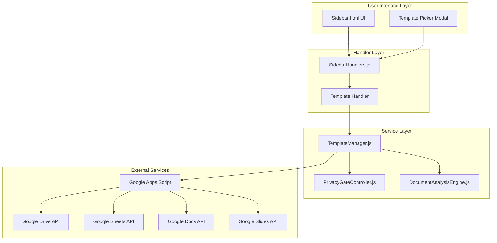
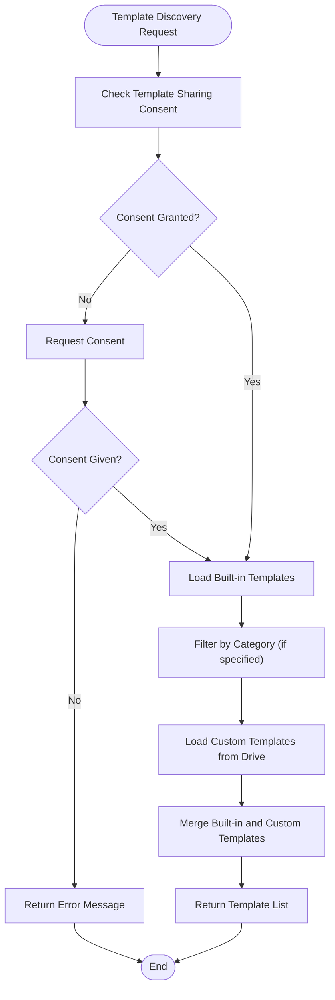
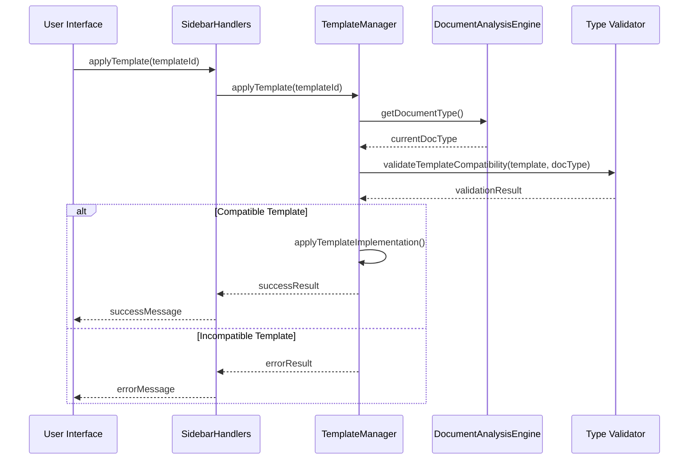
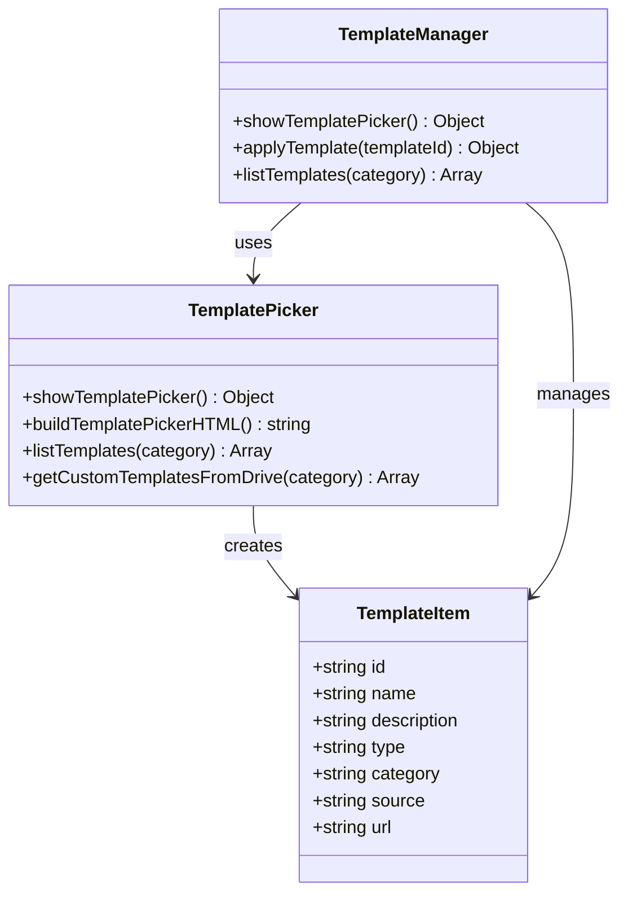
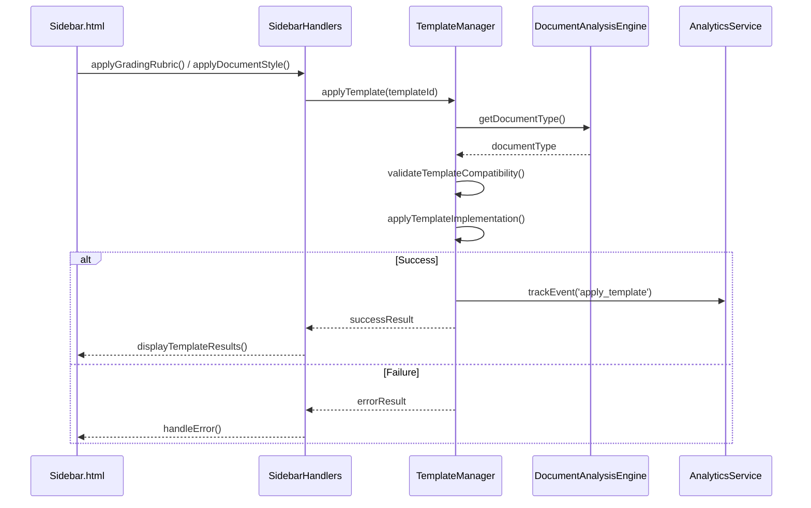
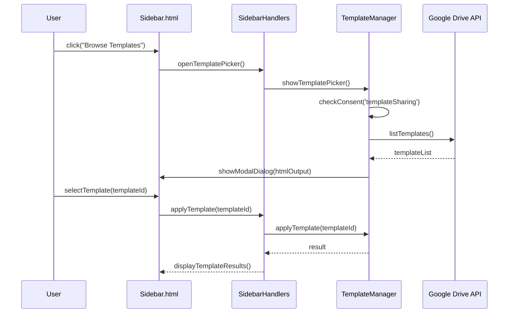
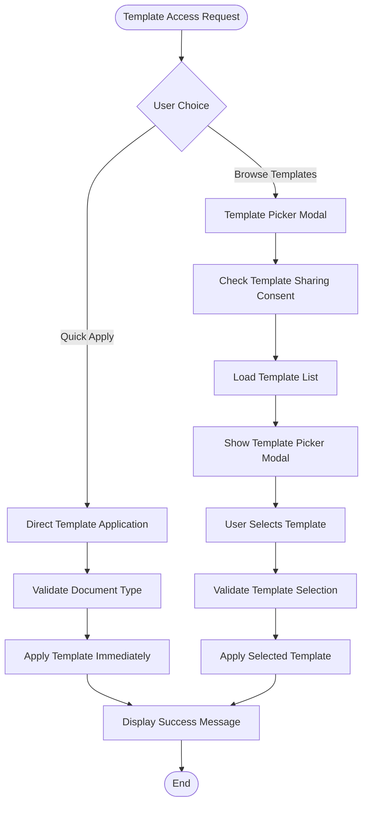
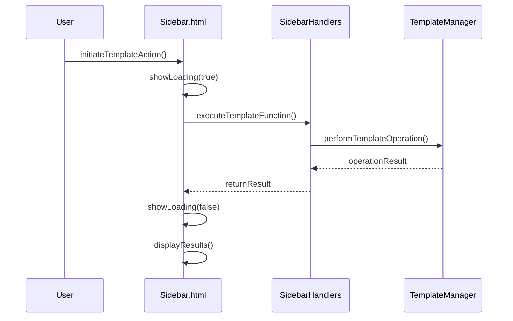
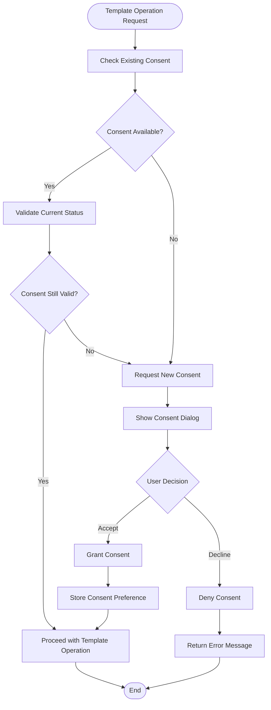
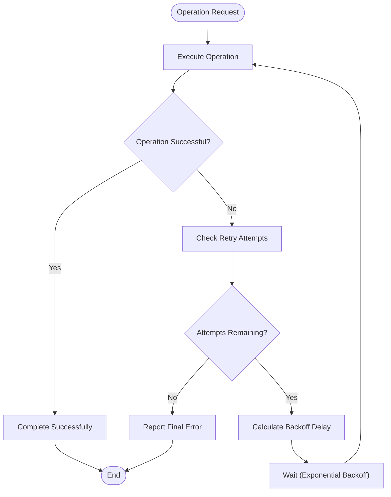

# Template Application Workflow

<cite>
**Referenced Files in This Document**
- [Sidebar.html](file://src/ui/Sidebar.html)
- [SidebarHandlers.js](file://src/handlers/SidebarHandlers.js)
- [TemplateManager.js](file://src/services/TemplateManager.js)
- [PrivacyGateController.js](file://src/services/PrivacyGateController.js)
- [Utils.js](file://src/utils/Utils.js)
- [README.md](file://README.md)
</cite>

## Table of Contents
1. [Introduction](#introduction)
2. [System Architecture Overview](#system-architecture-overview)
3. [Template Management System](#template-management-system)
4. [User Interface Components](#user-interface-components)
5. [Template Application Execution Flow](#template-application-execution-flow)
6. [Two Pathways for Template Access](#two-pathways-for-template-access)
7. [Visual Feedback and Loading States](#visual-feedback-and-loading-states)
8. [Template Preview Capabilities](#template-preview-capabilities)
9. [Privacy and Consent Management](#privacy-and-consent-management)
10. [Error Handling and Edge Cases](#error-handling-and-edge-cases)
11. [Performance Considerations](#performance-considerations)
12. [Troubleshooting Guide](#troubleshooting-guide)

## Introduction

The Techno Browser extension provides a sophisticated template application workflow that enables users to enhance their Google Workspace documents with pre-designed layouts and formatting. The system offers two distinct pathways for template access: built-in templates for immediate application and Google Drive integration for custom template libraries. This comprehensive workflow ensures seamless template application while maintaining strict privacy controls and providing intuitive visual feedback.

The template system serves multiple document types including Google Docs, Sheets, and Slides, with specialized templates for education, business, legal, and sales contexts. Users can access templates through the Templates tab in the sidebar interface, which provides both quick-action cards for commonly used templates and a comprehensive template browser for exploring the full library.

## System Architecture Overview

The template application workflow follows a layered architecture that separates concerns between user interface, business logic, and data management. The system is designed around three primary components: the user interface layer, the handler layer, and the service layer.

**Diagram sources**
- [Sidebar.html](file://src/ui/Sidebar.html#L278-L299)
- [SidebarHandlers.js](file://src/handlers/SidebarHandlers.js#L119-L146)
- [TemplateManager.js](file://src/services/TemplateManager.js#L6-L479)

The architecture ensures clear separation of responsibilities, with the UI layer handling user interactions, the handler layer managing business logic coordination, and the service layer providing core template management functionality. This design enables maintainable code and facilitates testing across different components.

**Section sources**
- [Sidebar.html](file://src/ui/Sidebar.html#L278-L299)
- [SidebarHandlers.js](file://src/handlers/SidebarHandlers.js#L119-L146)
- [TemplateManager.js](file://src/services/TemplateManager.js#L6-L479)

## Template Management System

The TemplateManager service serves as the central hub for all template-related operations, providing comprehensive functionality for template discovery, validation, and application. The system maintains a registry of built-in templates while supporting custom templates stored in Google Drive.

### Built-in Template Registry

The system includes five predefined templates organized by category:

| Template ID | Name | Type | Category | Description |
|-------------|------|------|----------|-------------|
| grading_rubric | Grading Rubric Template | SPREADSHEET | Education | Standard grading rubric for educators |
| document_style | Professional Document Style | DOCUMENT | Business | Professional formatting template for documents |
| presentation_clean | Clean Presentation Template | PRESENTATION | Business | Minimalist slide design template |
| contract_template | Legal Contract Template | DOCUMENT | Legal | Standard contract format with clauses |
| sales_report | Sales Report Template | SPREADSHEET | Sales | Monthly sales report template |

### Template Discovery and Listing

The template discovery mechanism operates through a hierarchical approach that prioritizes built-in templates while allowing for custom template integration:

**Diagram sources**
- [TemplateManager.js](file://src/services/TemplateManager.js#L87-L114)
- [TemplateManager.js](file://src/services/TemplateManager.js#L90-L111)

### Template Type Validation

The system performs comprehensive type validation to ensure template compatibility with the current document type. This validation prevents inappropriate template application and maintains document integrity:

**Diagram sources**
- [TemplateManager.js](file://src/services/TemplateManager.js#L158-L201)
- [SidebarHandlers.js](file://src/handlers/SidebarHandlers.js#L138-L146)

**Section sources**
- [TemplateManager.js](file://src/services/TemplateManager.js#L8-L59)
- [TemplateManager.js](file://src/services/TemplateManager.js#L87-L114)
- [TemplateManager.js](file://src/services/TemplateManager.js#L158-L201)

## User Interface Components

The template application interface consists of multiple interconnected components that provide intuitive access to template functionality. The primary interface element is the Templates tab within the sidebar, which presents both quick-action cards and comprehensive template browsing capabilities.

### Templates Tab Structure

The Templates tab organizes template access through a structured layout featuring:

1. **Browse Templates Button**: Provides access to the full template library through a modal dialog
2. **Quick-Apply Action Cards**: Direct application buttons for frequently used templates
3. **Template Results Container**: Displays success messages and feedback after template application

### Quick-Apply Action Cards

The system provides two dedicated action cards for immediate template application:

#### Grading Rubric Card
- **Purpose**: Apply standardized grading rubric to spreadsheet documents
- **Trigger Function**: `applyGradingRubric()`
- **Template Applied**: `grading_rubric`
- **Expected Outcome**: Pre-formatted spreadsheet with student grading columns

#### Document Style Card
- **Purpose**: Apply professional formatting to document content
- **Trigger Function**: `applyDocumentStyle()`
- **Template Applied**: `document_style`
- **Expected Outcome**: Enhanced document formatting with consistent typography

### Template Picker Modal

The template picker modal represents the primary interface for comprehensive template browsing and selection. This modal dialog provides:

- **Responsive Layout**: Optimized for 600x400 pixel dimensions
- **Template Categories**: Organized by business, education, legal, and sales contexts
- **Interactive Selection**: Click-to-apply functionality with immediate feedback
- **Loading States**: Progress indication during template retrieval

**Diagram sources**
- [TemplateManager.js](file://src/services/TemplateManager.js#L42-L76)
- [TemplateManager.js](file://src/services/TemplateManager.js#L423-L444)

**Section sources**
- [Sidebar.html](file://src/ui/Sidebar.html#L278-L299)
- [Sidebar.html](file://src/ui/Sidebar.html#L445-L478)
- [TemplateManager.js](file://src/services/TemplateManager.js#L42-L76)

## Template Application Execution Flow

The template application process follows a well-defined execution flow that ensures proper validation, consent management, and user feedback. This flow operates through multiple layers of abstraction, with each layer responsible for specific aspects of the template application process.

### Primary Execution Pathways

The system supports two distinct execution pathways for template application:

#### Direct Template Application
For built-in templates, the execution follows a streamlined path:

**Diagram sources**
- [SidebarHandlers.js](file://src/handlers/SidebarHandlers.js#L138-L146)
- [TemplateManager.js](file://src/services/TemplateManager.js#L158-L201)

#### Template Picker Selection
For custom template selection through the picker interface:

**Diagram sources**
- [SidebarHandlers.js](file://src/handlers/SidebarHandlers.js#L123-L127)
- [TemplateManager.js](file://src/services/TemplateManager.js#L42-L76)
- [SidebarHandlers.js](file://src/handlers/SidebarHandlers.js#L138-L146)

### Template Application Implementation

Each template type receives specialized handling based on its document format:

#### Spreadsheet Templates
- **Grading Rubric**: Creates formatted spreadsheet with student grading columns, formulas, and sample data
- **Sales Report**: Generates financial reporting template with date formatting, currency display, and calculation formulas

#### Document Templates
- **Professional Style**: Applies consistent typography, heading hierarchy, and formatting standards
- **Contract Template**: Implements legal document formatting with clause organization

#### Presentation Templates
- **Clean Presentation**: Standardizes slide text formatting and typography across all slides

**Section sources**
- [SidebarHandlers.js](file://src/handlers/SidebarHandlers.js#L119-L146)
- [TemplateManager.js](file://src/services/TemplateManager.js#L158-L201)
- [TemplateManager.js](file://src/services/TemplateManager.js#L204-L479)

## Two Pathways for Template Access

The template system provides dual access mechanisms to accommodate different user workflows and preferences. These pathways offer flexibility while maintaining consistent functionality and user experience.

### Pathway 1: Quick-Apply Templates

The quick-apply pathway targets users who need immediate template application without extensive exploration. This pathway provides direct access to the most commonly used templates through dedicated action cards.

#### Implementation Details
- **Direct Function Calls**: `applyGradingRubric()` and `applyDocumentStyle()` functions
- **Immediate Application**: Templates are applied without user confirmation
- **Minimal UI Interaction**: Single-click activation from the Templates tab
- **Pre-configured Templates**: Built-in templates with predefined configurations

#### Benefits
- **Speed**: Instant template application for frequent use cases
- **Simplicity**: Reduced cognitive load for straightforward template needs
- **Consistency**: Predictable behavior for established workflows

### Pathway 2: Template Browser Integration

The template browser pathway offers comprehensive template exploration and selection through an integrated Google Drive interface. This pathway supports both built-in templates and custom templates stored in the user's Google Drive.

#### Implementation Details
- **Modal Dialog Interface**: Responsive 600x400 pixel dialog for template selection
- **Dynamic Content Loading**: Templates loaded on-demand with category filtering
- **Google Drive Integration**: Access to custom templates stored in designated folders
- **Interactive Selection**: Click-to-apply with immediate feedback

#### Template Discovery Features
- **Category Organization**: Templates grouped by business, education, legal, and sales contexts
- **Type Filtering**: Document type-specific template listings
- **Source Indication**: Clear distinction between built-in and custom templates
- **Preview Capability**: Visual representation of template effects

**Diagram sources**
- [Sidebar.html](file://src/ui/Sidebar.html#L445-L478)
- [TemplateManager.js](file://src/services/TemplateManager.js#L42-L76)

**Section sources**
- [Sidebar.html](file://src/ui/Sidebar.html#L283-L295)
- [TemplateManager.js](file://src/services/TemplateManager.js#L42-L76)
- [TemplateManager.js](file://src/services/TemplateManager.js#L423-L444)

## Visual Feedback and Loading States

The template application system provides comprehensive visual feedback to enhance user experience and manage expectations during template operations. This feedback system operates across multiple interaction points and template application scenarios.

### Loading State Management

The system implements consistent loading state management through the `showLoading()` function, which controls visibility of the loading spinner and associated messaging.

#### Loading Indicators
- **Spinner Animation**: Rotating blue spinner with smooth animation
- **Progress Messaging**: "Processing..." text during template operations
- **Modal Blocking**: Loading state prevents user interaction during processing
- **Timeout Handling**: Automatic loading state management for long-running operations

#### Implementation Pattern
The loading state follows a consistent pattern across all template operations:

**Diagram sources**
- [Sidebar.html](file://src/ui/Sidebar.html#L322-L326)
- [Sidebar.html](file://src/ui/Sidebar.html#L445-L478)

### Success Message Display

Upon successful template application, the system provides immediate visual confirmation through the results container:

#### Success Message Components
- **Green Background**: Success-indicating green background with subtle border
- **Checkmark Icon**: Visual confirmation symbol
- **Descriptive Text**: Clear message indicating successful template application
- **Container Styling**: Consistent styling with other result containers

#### Message Types
- **Built-in Template Success**: "Applied [template name] successfully"
- **Custom Template Success**: "Applied Drive template: [filename]"
- **Batch Operation Success**: "Applied template with [count] modifications"

### Error State Handling

The system provides comprehensive error handling with clear visual feedback for various failure scenarios:

#### Error Categories
- **Permission Errors**: Template sharing consent required
- **Type Mismatch Errors**: Template incompatible with document type
- **Network Errors**: Google Drive connectivity issues
- **Validation Errors**: Invalid template parameters or document state

#### Error Display Strategy
- **Alert Dialogs**: Modal alerts for critical errors requiring immediate attention
- **Inline Messages**: Contextual error messages within the template results container
- **Retry Options**: Clear indication of recoverable error conditions
- **Help Links**: Guidance for resolving common error conditions

**Section sources**
- [Sidebar.html](file://src/ui/Sidebar.html#L301-L306)
- [Sidebar.html](file://src/ui/Sidebar.html#L474-L478)
- [SidebarHandlers.js](file://src/handlers/SidebarHandlers.js#L123-L146)

## Template Preview Capabilities

While the current implementation focuses on immediate template application, the system architecture supports preview functionality through its modular design and template discovery mechanisms. The preview capability would enable users to visualize template effects before committing to application.

### Current Preview Infrastructure

The template picker interface provides foundational infrastructure for preview functionality:

#### Template Listing with Descriptions
The system maintains comprehensive template metadata including:
- **Names**: Descriptive template identifiers
- **Descriptions**: Purpose and intended use cases
- **Categories**: Organizational classification
- **Types**: Document format compatibility

#### Interactive Template Selection
The modal dialog interface supports interactive template selection with:
- **Hover Effects**: Visual feedback on template items
- **Click-to-Apply**: Immediate application upon selection
- **Category Filtering**: Dynamic template filtering by document type

### Preview Implementation Architecture

The preview system would operate through several key components:

#### Template Rendering Engine
- **Document Simulation**: Render template effects without permanent modification
- **Live Preview**: Real-time updates as users explore different templates
- **Export Capability**: Save preview results as temporary documents

#### Preview State Management
- **Temporary Documents**: Isolated preview environments
- **Undo Capability**: Ability to discard preview changes
- **State Persistence**: Maintain preview session across interactions

### Future Preview Enhancements

The system architecture supports several preview enhancement possibilities:

#### Visual Preview Thumbnails
- **Screenshot Generation**: Automated thumbnail creation for each template
- **Interactive Previews**: Click-to-view detailed previews
- **Comparison Views**: Side-by-side template comparisons

#### Live Editing Previews
- **Editable Previews**: Modify template parameters before application
- **Real-time Updates**: Live preview updates as users adjust settings
- **Export Options**: Download preview as template for future use

**Section sources**
- [TemplateManager.js](file://src/services/TemplateManager.js#L423-L444)
- [TemplateManager.js](file://src/services/TemplateManager.js#L87-L114)

## Privacy and Consent Management

The template application system implements comprehensive privacy controls through the PrivacyGateController service, ensuring compliance with privacy regulations while enabling template sharing functionality. The consent management system operates on granular privacy controls with explicit user approval for sensitive operations.

### Consent Types and Management

The system defines specific consent categories for template-related operations:

#### Template Sharing Consent
- **Purpose**: Access to shared template library from Google Drive
- **Scope**: Read access to user's Google Drive files
- **Requirement**: Explicit user approval before accessing custom templates
- **Reversibility**: Users can revoke consent at any time

#### Consent Validation Process
The system validates consent requirements before template operations:

**Diagram sources**
- [PrivacyGateController.js](file://src/services/PrivacyGateController.js#L89-L144)
- [TemplateManager.js](file://src/services/TemplateManager.js#L48-L61)

### Privacy Policy Compliance

The system adheres to strict privacy principles:

#### Data Processing Principles
- **Local Processing**: Template operations occur within Google Apps Script environment
- **No Data Transmission**: Template content remains within Google's infrastructure
- **User Control**: Explicit consent required for external template access
- **Minimal Scope**: Request only necessary Google Drive permissions

#### Consent Management Features
- **Granular Controls**: Separate consent for different template types
- **Audit Trail**: Logging of consent decisions and changes
- **Revocation Capability**: Users can withdraw consent at any time
- **Transparent Communication**: Clear explanations of template access purposes

### Template Data Security

The system implements security measures for template data:

#### Access Control
- **Document Isolation**: Templates accessed within document context only
- **Permission Boundaries**: Respects Google Workspace permission model
- **Secure Storage**: Template metadata stored securely in user properties

#### Data Protection
- **No Persistent Storage**: Template content not stored permanently
- **Encrypted Transmission**: All communications use HTTPS encryption
- **Temporary Access**: Consent-based temporary access to external resources

**Section sources**
- [PrivacyGateController.js](file://src/services/PrivacyGateController.js#L89-L144)
- [TemplateManager.js](file://src/services/TemplateManager.js#L48-L61)
- [PrivacyGateController.js](file://src/services/PrivacyGateController.js#L102-L126)

## Error Handling and Edge Cases

The template application system implements comprehensive error handling to manage various failure scenarios and edge cases. This robust error management ensures graceful degradation and provides meaningful feedback to users.

### Common Error Scenarios

#### Template Compatibility Errors
- **Document Type Mismatch**: Attempting to apply spreadsheet template to document
- **Invalid Template ID**: Reference to non-existent or corrupted template
- **Missing Dependencies**: Required formatting elements unavailable in current document

#### Permission and Access Errors
- **Consent Denial**: User declines template sharing consent
- **Drive Access Issues**: Google Drive connectivity problems
- **File Not Found**: Specified template file missing from Drive

#### System Resource Errors
- **Quota Exceeded**: Google Apps Script quota limitations
- **Timeout Errors**: Long-running template operations
- **Memory Constraints**: Large document processing limitations

### Error Handling Implementation

The system implements multi-layered error handling:

#### Frontend Error Management
- **Loading States**: Prevent user interaction during error conditions
- **Error Alerts**: Clear notification of error conditions
- **Retry Mechanisms**: Automatic retry for transient failures
- **Fallback Options**: Alternative approaches when primary methods fail

#### Backend Error Recovery
- **Graceful Degradation**: Continue operation with reduced functionality
- **Logging and Monitoring**: Comprehensive error logging for debugging
- **User Feedback**: Meaningful error messages for user resolution
- **State Recovery**: Restore system state after error conditions

### Error Recovery Strategies

#### Automatic Retry Logic
For transient failures, the system implements exponential backoff retry:

**Diagram sources**
- [Utils.js](file://src/utils/Utils.js#L97-L113)

#### Graceful Degradation
When critical failures occur, the system provides alternative solutions:

- **Built-in Fallbacks**: Use alternative templates when preferred ones unavailable
- **Partial Application**: Apply template elements that succeed while skipping problematic parts
- **User Guidance**: Provide clear instructions for resolving common issues

### Error Prevention Mechanisms

#### Input Validation
- **Template ID Verification**: Validate template identifiers before application
- **Document Type Checking**: Confirm document compatibility before template application
- **Permission Verification**: Check required permissions before attempting operations

#### Resource Monitoring
- **Quota Tracking**: Monitor Google Apps Script quota usage
- **Performance Metrics**: Track operation timing and resource consumption
- **Health Checks**: Periodic system health verification

**Section sources**
- [TemplateManager.js](file://src/services/TemplateManager.js#L158-L201)
- [SidebarHandlers.js](file://src/handlers/SidebarHandlers.js#L123-L146)
- [Utils.js](file://src/utils/Utils.js#L97-L113)

## Performance Considerations

The template application system is designed with performance optimization in mind, addressing various scalability challenges and resource constraints inherent in Google Workspace add-on development.

### Template Loading Optimization

#### Lazy Loading Strategy
- **On-Demand Loading**: Templates loaded only when needed
- **Incremental Loading**: Large template libraries loaded in batches
- **Caching Mechanism**: Frequently accessed templates cached in memory
- **Category Filtering**: Reduce template list size through client-side filtering

#### Memory Management
- **Template Object Lifecycle**: Proper cleanup of template objects after use
- **DOM Element Reuse**: Efficient DOM manipulation for template picker
- **Event Listener Management**: Proper cleanup of event listeners
- **Resource Pooling**: Reuse of expensive objects where possible

### Google Apps Script Quotas

The system operates within Google Apps Script limitations:

#### Execution Time Management
- **Async Operations**: Non-blocking template operations
- **Chunked Processing**: Large templates processed in smaller segments
- **Progress Reporting**: User feedback during long operations
- **Timeout Handling**: Graceful handling of execution timeouts

#### API Rate Limiting
- **Batch Operations**: Group related API calls to minimize overhead
- **Request Throttling**: Controlled rate of API calls
- **Circuit Breaker**: Automatic fallback when APIs become unresponsive
- **Retry Logic**: Intelligent retry with exponential backoff

### Scalability Features

#### Horizontal Scaling
- **Template Distribution**: Support for distributed template storage
- **Load Balancing**: Multiple template sources for redundancy
- **Geographic Distribution**: Regional template server availability
- **Content Delivery**: Optimized template delivery networks

#### Vertical Scaling
- **Memory Optimization**: Efficient memory usage patterns
- **CPU Utilization**: Optimized algorithms for template processing
- **Storage Efficiency**: Compressed template storage formats
- **Network Optimization**: Minimized data transfer requirements

### Performance Monitoring

#### Metrics Collection
- **Operation Timing**: Track template application duration
- **Success Rates**: Monitor template application success rates
- **Error Patterns**: Identify common failure scenarios
- **User Experience**: Measure perceived performance

#### Optimization Opportunities
- **Template Preprocessing**: Cache processed templates
- **Client-Side Validation**: Reduce server-side validation overhead
- **Parallel Processing**: Concurrent template operations where possible
- **Resource Prioritization**: Prioritize critical template operations

**Section sources**
- [TemplateManager.js](file://src/services/TemplateManager.js#L42-L76)
- [Utils.js](file://src/utils/Utils.js#L204-L236)

## Troubleshooting Guide

This comprehensive troubleshooting guide addresses common issues encountered during template application and provides systematic resolution approaches.

### Common Issues and Solutions

#### Template Access Problems

**Issue**: "Template access requires Drive permission" error
- **Cause**: User denied template sharing consent
- **Solution**: 
  1. Click "Privacy & Permissions" in add-on menu
  2. Enable "Template Sharing" consent
  3. Restart template operation
- **Prevention**: Grant template sharing consent during initial setup

**Issue**: Template picker fails to load
- **Cause**: Network connectivity or Google Drive API issues
- **Solution**:
  1. Check internet connection
  2. Verify Google Drive accessibility
  3. Clear browser cache and reload
  4. Try alternative browser
- **Alternative**: Use quick-apply templates instead of picker

#### Template Application Failures

**Issue**: "Template is for [type] but current document is [type]" error
- **Cause**: Template type mismatch with current document
- **Solution**:
  1. Verify document type matches template requirements
  2. Use appropriate template for document format
  3. Convert document format if necessary
- **Example**: Cannot apply spreadsheet template to Google Doc

**Issue**: Template application takes excessive time
- **Cause**: Large document size or complex template
- **Solution**:
  1. Process smaller document sections
  2. Close other Google Workspace applications
  3. Wait for completion (up to several minutes for large documents)
  4. Consider upgrading to Google Workspace account for longer execution time

#### Permission and Authorization Issues

**Issue**: "Authorization required" error
- **Cause**: Insufficient Google Workspace permissions
- **Solution**:
  1. Sign out and sign back into Google account
  2. Check Google Workspace admin policies
  3. Contact administrator for permission adjustments
  4. Verify add-on installation status

**Issue**: Template preview unavailable
- **Cause**: Preview functionality not yet implemented
- **Solution**: Use template descriptions and quick-apply options
- **Workaround**: Apply templates directly and review results

### Diagnostic Procedures

#### System Health Check
1. **Verify Add-on Installation**: Confirm add-on appears in Google Workspace menu
2. **Test Basic Functionality**: Run document analysis to verify core functionality
3. **Check Internet Connectivity**: Ensure stable internet connection
4. **Validate Google Account**: Confirm account has Google Workspace access

#### Template System Verification
1. **Consent Status**: Check template sharing consent status
2. **Document Type**: Verify document format compatibility
3. **Available Templates**: Confirm template library accessibility
4. **Error History**: Review recent error messages and patterns

### Support Resources

#### Documentation Resources
- **User Manual**: Comprehensive guide available in add-on help
- **FAQ Section**: Frequently asked questions and solutions
- **Video Tutorials**: Step-by-step video demonstrations
- **Community Forums**: User discussions and shared solutions

#### Technical Support
- **Bug Reports**: Submit detailed bug reports through GitHub Issues
- **Feature Requests**: Propose new template types or functionality
- **Performance Issues**: Report slow operation or timeout problems
- **Compatibility Problems**: Report issues with specific document types

**Section sources**
- [TemplateManager.js](file://src/services/TemplateManager.js#L48-L61)
- [SidebarHandlers.js](file://src/handlers/SidebarHandlers.js#L123-L146)
- [PrivacyGateController.js](file://src/services/PrivacyGateController.js#L89-L144)