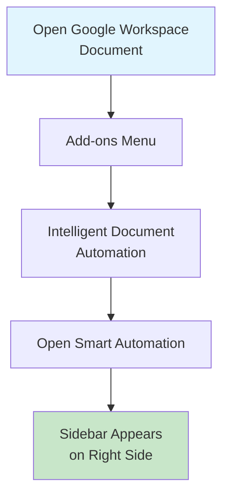
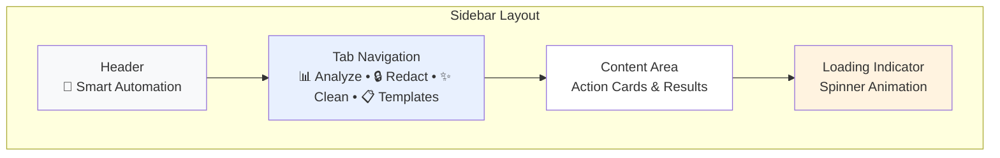
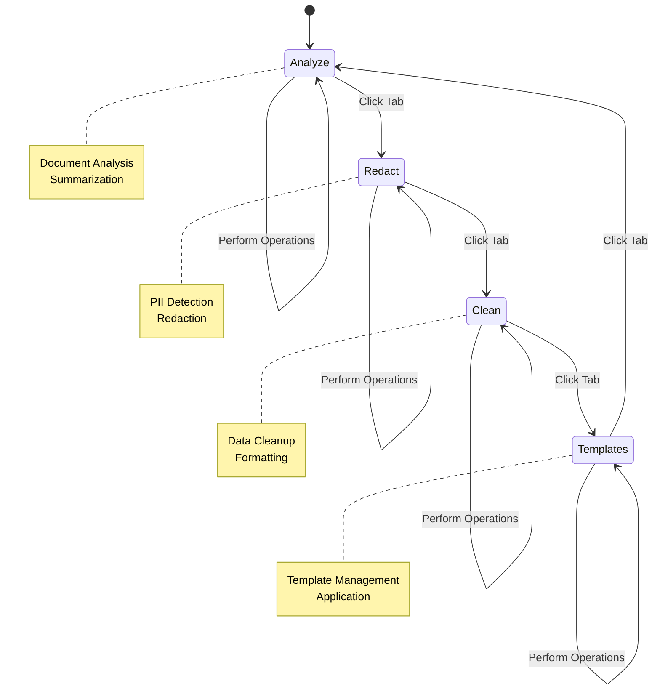
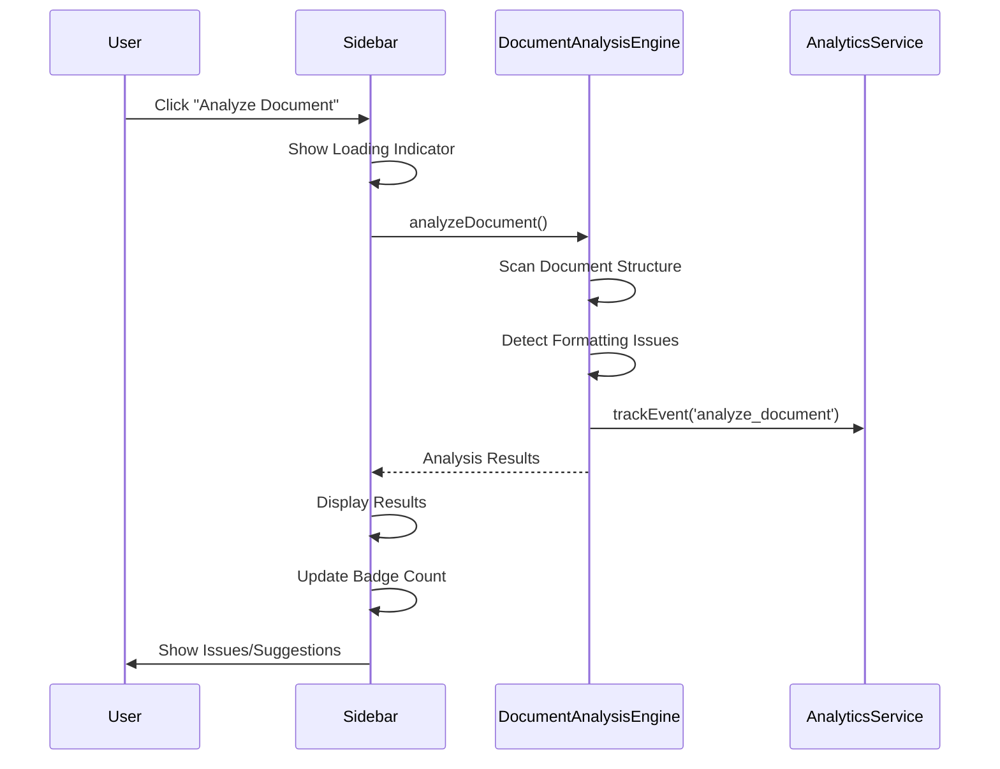
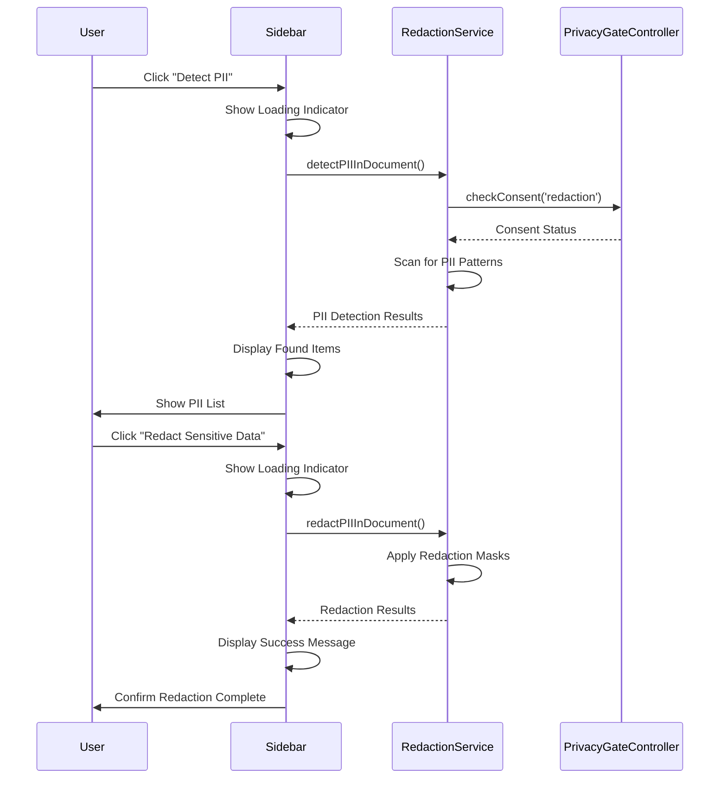
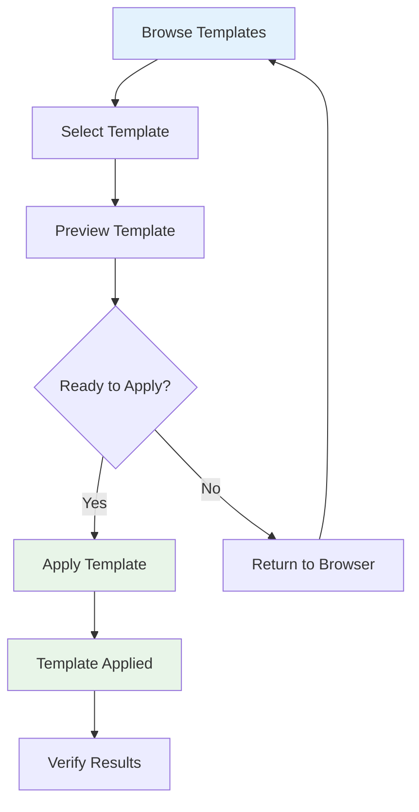
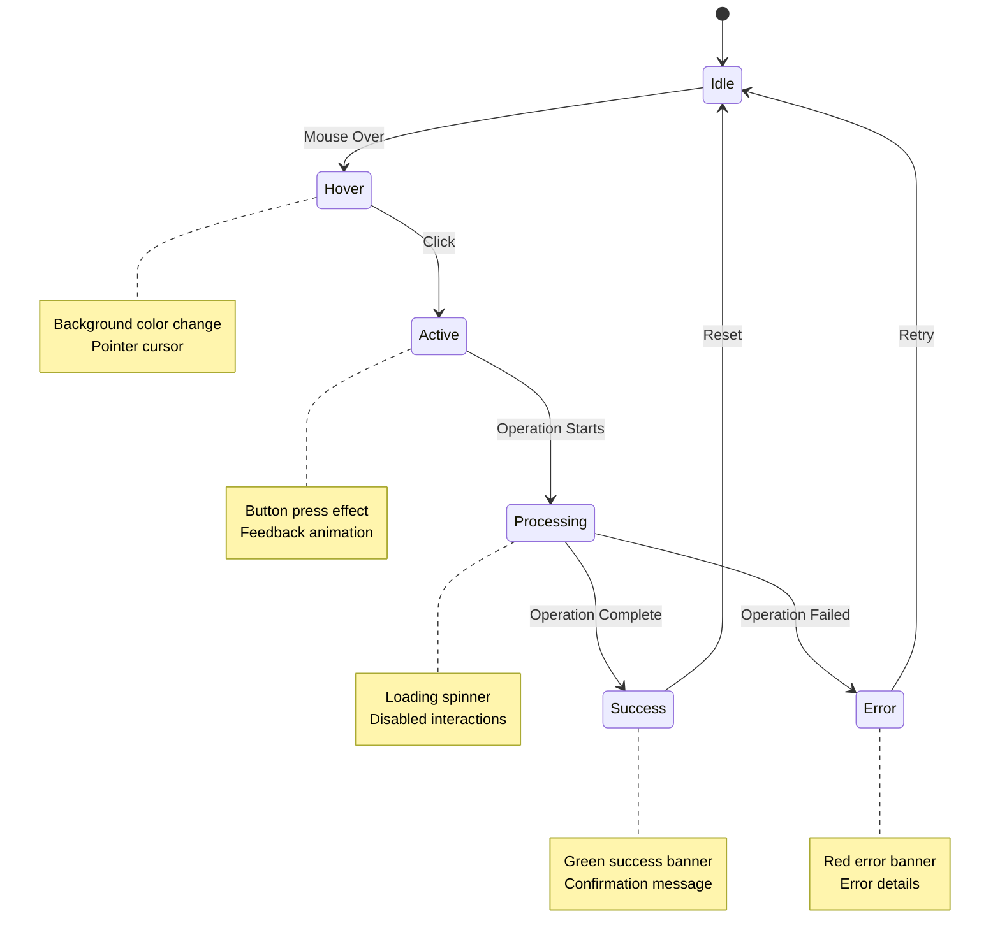
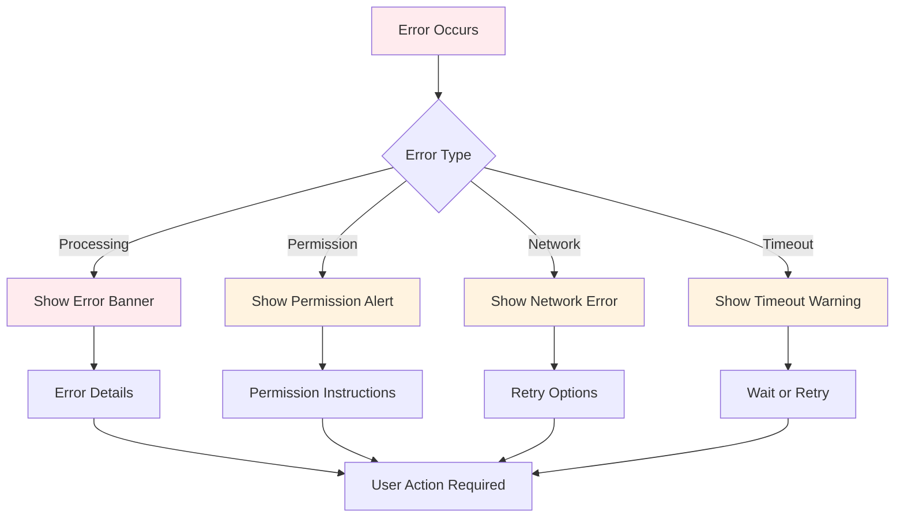
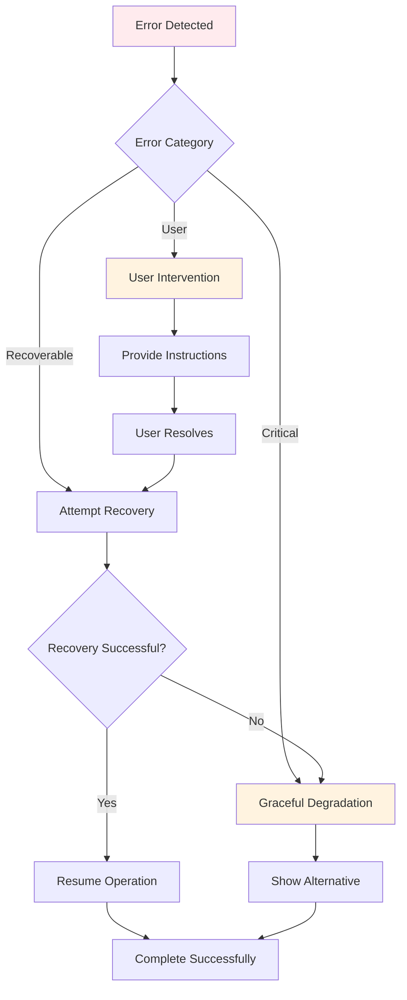

# User Guide

<cite>
**Referenced Files in This Document**
- [Sidebar.html](file://src/ui/Sidebar.html)
- [SidebarHandlers.js](file://src/handlers/SidebarHandlers.js)
- [Main.js](file://src/Main.js)
- [DocumentAnalysisEngine.js](file://src/services/DocumentAnalysisEngine.js)
- [RedactionService.js](file://src/services/RedactionService.js)
- [SummarizationService.js](file://src/services/SummarizationService.js)
- [appsscript.json](file://appsscript.json)
- [README.md](file://README.md)
</cite>

## Table of Contents
1. [Introduction](#introduction)
2. [Getting Started](#getting-started)
3. [Opening the Sidebar](#opening-the-sidebar)
4. [Understanding the Interface](#understanding-the-interface)
5. [Navigating Between Tabs](#navigating-between-tabs)
6. [Core Workflows](#core-workflows)
7. [User Interaction Patterns](#user-interaction-patterns)
8. [Visual Feedback and Notifications](#visual-feedback-and-notifications)
9. [Keyboard Shortcuts and Accessibility](#keyboard-shortcuts-and-accessibility)
10. [Error Handling and Troubleshooting](#error-handling-and-troubleshooting)
11. [Advanced Features](#advanced-features)
12. [Best Practices](#best-practices)

## Introduction

The Techno Browser extension is a powerful Google Workspace add-on that transforms your document workflow with intelligent automation capabilities. Designed to work seamlessly across Google Docs, Sheets, and Slides, it provides automated solutions for document analysis, privacy protection, data cleanup, and template management.

The extension operates through an intuitive sidebar interface that allows users to perform complex operations with simple clicks while maintaining strict privacy standards. All processing occurs locally within Google Apps Script by default, ensuring your data remains secure and private.

## Getting Started

### Installation and Setup

Before using the extension, ensure you have:
- Access to Google Workspace (Google Docs, Sheets, or Slides)
- Administrative approval for add-on installation (if required)
- Active internet connection for advanced features

### Initial Configuration

Upon first installation, the extension automatically creates menu items in your Google Workspace applications. No additional setup is required for basic functionality.

**Section sources**
- [README.md](file://README.md#L117-L123)

## Opening the Sidebar

### Method 1: From Google Workspace Menu

1. **Open your document**: Launch any Google Doc, Sheet, or Slide
2. **Navigate to Add-ons**: Click the "Add-ons" menu in the toolbar
3. **Select the Extension**: Choose "Intelligent Document Automation"
4. **Open Sidebar**: Click "Open Smart Automation"

### Method 2: Direct Access

The sidebar can also be accessed directly through the main menu system that appears automatically when you open a supported document.

**Diagram sources**
- [Main.js](file://src/Main.js#L15-L61)

**Section sources**
- [Main.js](file://src/Main.js#L152-L161)

## Understanding the Interface

The sidebar interface is designed with simplicity and efficiency in mind, featuring a clean layout with clearly labeled sections and intuitive navigation.

### Interface Components

**Diagram sources**
- [Sidebar.html](file://src/ui/Sidebar.html#L200-L493)

### Key Interface Elements

| Element | Purpose | Visual Indicator |
|---------|---------|------------------|
| **Header** | Branding and title | "🤖 Smart Automation" with subtitle |
| **Tab Navigation** | Switch between functional areas | Horizontal tabs with active state |
| **Action Cards** | Primary operations | Clickable cards with icons and descriptions |
| **Results Display** | Operation outcomes | Color-coded feedback boxes |
| **Loading Indicator** | Processing status | Spinner animation with text |

**Section sources**
- [Sidebar.html](file://src/ui/Sidebar.html#L200-L306)

## Navigating Between Tabs

The sidebar is organized into five distinct functional tabs, each serving specific automation purposes:

### Tab Structure

**Diagram sources**
- [Sidebar.html](file://src/ui/Sidebar.html#L206-L211)

### Tab Descriptions

| Tab | Icon | Primary Functions | Use Cases |
|-----|------|-------------------|-----------|
| **Analyze** | 📊 | Document analysis, content summarization | Quality checks, content review |
| **Redact** | 🔒 | PII detection, sensitive data masking | Privacy compliance, data protection |
| **Clean** | ✨ | Data cleanup, formatting standardization | Data preparation, consistency |
| **Templates** | 📋 | Template browsing, application | Document standardization, formatting |

**Section sources**
- [Sidebar.html](file://src/ui/Sidebar.html#L206-L211)

## Core Workflows

### Document Analysis Workflow

The analysis workflow helps users identify and resolve formatting issues, content inconsistencies, and structural problems.

**Diagram sources**
- [SidebarHandlers.js](file://src/handlers/SidebarHandlers.js#L10-L20)
- [Sidebar.html](file://src/ui/Sidebar.html#L328-L357)

#### Step-by-Step Analysis Process

1. **Initiate Analysis**: Click "🔍 Analyze Document" in the Analyze tab
2. **Processing**: Wait for the loading spinner to complete
3. **Results Review**: Examine detected issues and suggested improvements
4. **Action Selection**: Click specific suggestions to apply fixes
5. **Validation**: Verify changes and continue if satisfied

**Section sources**
- [SidebarHandlers.js](file://src/handlers/SidebarHandlers.js#L10-L20)
- [DocumentAnalysisEngine.js](file://src/services/DocumentAnalysisEngine.js#L12-L30)

### PII Detection and Redaction Workflow

Privacy protection is handled through a two-stage process: detection followed by redaction.

**Diagram sources**
- [SidebarHandlers.js](file://src/handlers/SidebarHandlers.js#L47-L74)
- [RedactionService.js](file://src/services/RedactionService.js#L48-L68)

#### PII Redaction Process

1. **Detection Phase**: Scan document for sensitive information
2. **Review Phase**: Examine identified PII items
3. **Redaction Phase**: Apply masking to detected sensitive data
4. **Verification**: Confirm successful redaction

**Section sources**
- [SidebarHandlers.js](file://src/handlers/SidebarHandlers.js#L47-L74)
- [RedactionService.js](file://src/services/RedactionService.js#L48-L181)

### Template Application Workflow

Templates provide standardized formatting and structure for various document types.

**Diagram sources**
- [SidebarHandlers.js](file://src/handlers/SidebarHandlers.js#L120-L146)

**Section sources**
- [SidebarHandlers.js](file://src/handlers/SidebarHandlers.js#L120-L146)

## User Interaction Patterns

### Click-to-Action Interface

The extension follows a consistent click-to-action pattern where users initiate operations by clicking on action cards or buttons.

#### Interaction States

**Diagram sources**
- [Sidebar.html](file://src/ui/Sidebar.html#L54-L67)

### Responsive Design Features

The interface adapts to different screen sizes and interaction methods:

- **Hover Effects**: Cards change appearance when hovered
- **Click Feedback**: Visual feedback during button presses
- **Loading States**: Clear indication of processing status
- **Responsive Layout**: Adapts to sidebar width constraints

**Section sources**
- [Sidebar.html](file://src/ui/Sidebar.html#L54-L67)

## Visual Feedback and Notifications

### Success Indicators

The extension provides immediate visual feedback for completed operations:

| Success Type | Visual Treatment | Duration | Dismissal |
|--------------|------------------|----------|-----------|
| **Operation Complete** | Green results box | Permanent until next operation | Automatic reset |
| **Item Count** | Badge with count | Until next analysis | Automatic update |
| **Confirmation Messages** | Success notification | 3 seconds | Auto-dismiss |
| **Progress Updates** | Loading spinner | While processing | Manual completion |

### Error Communication

Error states are communicated clearly with actionable information:

**Diagram sources**
- [Sidebar.html](file://src/ui/Sidebar.html#L480-L484)

**Section sources**
- [Sidebar.html](file://src/ui/Sidebar.html#L480-L484)

## Keyboard Shortcuts and Accessibility

### Accessibility Features

The extension incorporates several accessibility enhancements:

- **Screen Reader Support**: Proper ARIA labels and semantic HTML
- **Keyboard Navigation**: Full functionality via keyboard
- **High Contrast**: Clear visual hierarchy and color contrast
- **Focus Indicators**: Visible focus rings for keyboard users

### Interactive Elements

| Element | Keyboard Access | Screen Reader Support |
|---------|-----------------|----------------------|
| **Tabs** | Tab/Shift+Tab | Screen reader announces current tab |
| **Action Cards** | Enter/Space | Description read aloud |
| **Buttons** | Enter/Space | Button label announced |
| **Loading States** | Automatic | Progress announcements |

**Section sources**
- [Sidebar.html](file://src/ui/Sidebar.html#L307-L490)

## Error Handling and Troubleshooting

### Common Error Scenarios

The extension handles various error conditions gracefully:

#### Processing Errors
- **Large Documents**: Automatic chunking and progress reporting
- **Memory Constraints**: Progressive processing with status updates
- **Timeout Issues**: Graceful degradation with partial results

#### Permission Errors
- **Missing Scopes**: Clear permission prompts with explanations
- **Domain Restrictions**: Informative messages about administrative controls
- **Feature Dependencies**: Guidance for enabling required services

#### Network and Connectivity
- **API Failures**: Fallback to local processing when possible
- **Rate Limiting**: Intelligent retry mechanisms
- **Offline Mode**: Offline capability for basic operations

### Error Recovery Mechanisms

**Diagram sources**
- [SidebarHandlers.js](file://src/handlers/SidebarHandlers.js#L18-L20)

**Section sources**
- [SidebarHandlers.js](file://src/handlers/SidebarHandlers.js#L18-L20)

## Advanced Features

### Privacy Controls

The extension provides granular privacy controls for sensitive operations:

#### Consent Management
- **PII Detection**: Explicit consent required for scanning sensitive data
- **Advanced AI**: Additional consent for external AI processing
- **Analytics**: User opt-in for usage tracking

#### Data Protection
- **Local Processing**: All operations occur within Google Apps Script
- **No Data Storage**: No document content stored externally
- **Temporary Processing**: Data processed in memory only

### Template System

The template system offers extensive customization and management:

#### Built-in Templates
- **Grading Rubrics**: Academic assessment templates
- **Business Documents**: Professional report formats
- **Presentation Styles**: Consistent slide designs
- **Contract Templates**: Legal document frameworks

#### Custom Templates
- **Import from Drive**: Bring your own templates
- **Custom Creation**: Build templates from scratch
- **Version Control**: Track template modifications

**Section sources**
- [SidebarHandlers.js](file://src/handlers/SidebarHandlers.js#L120-L146)

## Best Practices

### Efficient Workflow Management

1. **Batch Similar Operations**: Group related tasks together
2. **Use Selection Mode**: Work with specific document portions
3. **Leverage Templates**: Standardize recurring document formats
4. **Monitor Progress**: Pay attention to loading indicators
5. **Backup Important Documents**: Use version history features

### Privacy and Security

1. **Review Consent Settings**: Understand what data is processed
2. **Regular Audits**: Periodically check privacy settings
3. **Team Coordination**: Ensure team members understand privacy implications
4. **Documentation Standards**: Maintain consistent document formatting

### Performance Optimization

1. **Document Size Management**: Break large documents into smaller sections
2. **Network Reliability**: Ensure stable internet connection for advanced features
3. **Resource Monitoring**: Watch for memory usage in large documents
4. **Scheduled Maintenance**: Regular cleanup of temporary data

**Section sources**
- [README.md](file://README.md#L158-L189)